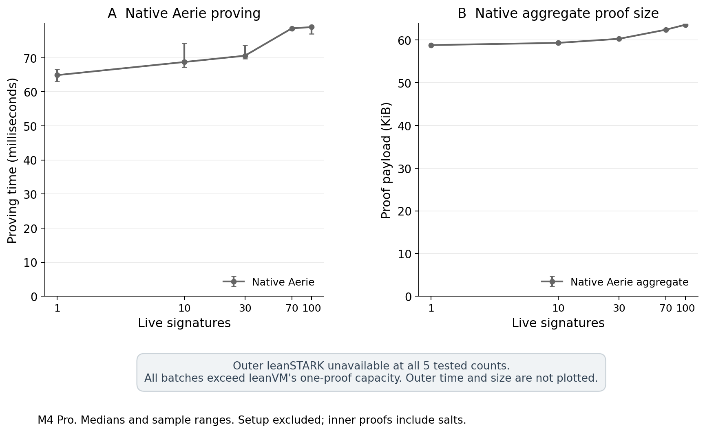
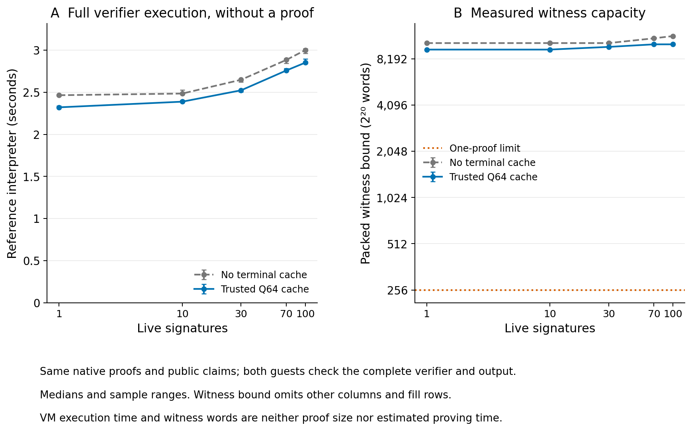

# Aerie under leanVM: a complete verifier, a proving limit

We implemented the complete Aerie verifier as a leanVM RV64IM guest and tested real Falcon aggregates of 1, 10, 30, 70 and 100 signatures. Every valid aggregate executes and produces the expected statement commitment. **None fits one STARK in the pinned backend.** Actual prover calls fail its commitment-capacity check, including the one-signature case. We therefore have complete execution measurements, native Aerie proof sizes and a measured obstacle to outer proving. We do not have an Aerie leanSTARK size or proving-time curve.

This extends the [signature aggregation study](leanvm-signature-aggregation.md). The original custom-ISA benchmarks and recursive signature trees remain separate. The new port uses leanEthereum/leanVM's [RISC-V branch at `06e5c9c`](https://github.com/leanEthereum/leanVM/tree/06e5c9cd6981103786f9d0a17324241b559a50d3), rather than the old custom ISA.

Aerie is an interesting intermediate layer for an off-chain wallet aggregator: wallets send ordinary signatures, Aerie aggregates them, and leanVM would certify one aggregate verification. That could eventually serve the generic-verifier route around [EIP-8141](https://eips.ethereum.org/EIPS/eip-8141) and [EIP-8288](https://eips.ethereum.org/EIPS/eip-8288). This project does not implement either EIP's transaction or dependency-frame rules.

The [Aerie paper](https://eprint.iacr.org/2026/2501) uses Akita commitments, three sumcheck stages and one batched opening to prove Falcon's equation, norm and padded-format conditions. Existing verification is available through [`verify_aggregate`](https://github.com/a16z/aerie/blob/49b6c212c209286c536196f53618823ffdf0e899/crates/aerie-verifier/src/lib.rs). We pin [Aerie v0.2.0](https://github.com/a16z/aerie/tree/49b6c212c209286c536196f53618823ffdf0e899), Akita `e023b6a`, Jolt `c7c2d08` and Spongefish `ef97413`.

The released relation uses `fn-dsa` 0.3.0, 666-byte padded Falcon-512 signatures and key-prefixed Falcon-v1.2 SHAKE framing. It is different from ethFalcon and from the earlier article's round-3 Falcon inputs. Those signatures cannot be passed to this verifier unchanged. An ethFalcon adaptation would need its own target derivation, compatibility checks and security analysis.

The port supplies deterministic allocation, in-memory Rust I/O and single-hart synchronization. The guest canonically parses ordered keys and messages, checks framing/count, recomputes key/salt/message binding and HashToPoint, replays the original BLAKE2b transcript and work nonces, and executes every projection, sumcheck and Akita opening check. No native acceptance bit or unchecked target table replaces verification.

Public matrix data and the terminal NTT cache are derived and validated natively, then compiled into the trusted ELF. Their source-controlled hashes, descriptors and identities are checked. The owned Q64 cache adapter preserves exact CRT capacity, tail, residue and schedule checks. These are fixed public parameters, not prover advice. A valid-looking cache supplied by an untrusted prover would be unsafe.

The guest commits `SHAKE256(domain || profile || count || canonical_statement)`, with explicit length framing, only after acceptance. The receiver derives the expected SDK output from its intended ordered keys/messages and pins the trusted ELF before full proof verification. An inner aggregate and its salts could be outer witnesses. Receivers still need transaction/account data to reconstruct the authorized public keys and messages.

This is one Aerie aggregate checked by one VM execution. It does not recursively verify a tree of leanVM child proofs. The separate recursive signature-tree benchmarks retain their own costs and verification boundary.

| Signatures | Native Aerie prove, ms | Aerie wire proof, KiB | Full VM execution, s | Outer STARK |
|---:|---:|---:|---:|---|
| 1 | 64.9 | 58.83 | 2.321 | Capacity exceeded |
| 10 | 68.7 | 59.35 | 2.388 | Capacity exceeded |
| 30 | 70.6 | 60.30 | 2.523 | Capacity exceeded |
| 70 | 78.6 | 62.44 | 2.759 | Capacity exceeded |
| 100 | 79.0 | 63.61 | 2.853 | Capacity exceeded |

These are M4 Pro measurements with 24 GiB RAM, one warmup and three measured native proofs per point. Native Aerie uses 12 workers. Each resulting proof runs through the complete single-hart guest and checks its expected output. Setup, signing, fixture generation, compilation and ELF loading are separate. The VM column measures reference interpretation, not proving. Native verification takes 2.75 to 3.46 ms for these five points and starts from the parsed statement.

The same-source baseline prepares terminal transforms inside the guest. Compiling validated transforms into the ELF reduces N=1 execution from 2.465 to 2.321 seconds, and N=100 from 3.002 to 2.853 seconds. The complete cached runs still execute about 276 to 335 million instructions. Each selected terminal cache is 688,248 bytes of public deployment data; these bytes would not be added to each outer proof.

The backend allows at most `2^28` witness words and has no continuations. At one signature, just the packed class/clock witnesses require at least 9.85 billion words, 36.69 times that capacity. At 100 signatures the bound is 10.65 billion words, 39.69 times capacity. Other committed columns and extra fill rows are omitted, so this is a lower bound. It is neither compressed proof size nor a predicted proving time. The static code/memory floor fits; actual execution causes the rejection.

The scalar port is therefore not a practical outer prover in this revision. A larger batch does not amortize away its fixed verification work. Public preprocessing helps modestly, while software SHAKE/BLAKE2b, projections and prime-field arithmetic remain expensive. A tree of outer proofs does not fix an oversized one-signature verifier leaf; splitting verification needs authenticated intermediate state. Lifting a size constant alone would require sound new commitment parameters and far more memory. Authenticated continuations, a circuit-oriented verifier, or efficient constrained arithmetic/hash operations are the relevant next designs. This experiment does not implement them.

The earlier native-only experiment remains useful at larger sizes:

| Signatures | Native prove, 12 workers, ms | Native verify, 1 worker, ms | Aggregate, KiB |
|---:|---:|---:|---:|
| 100 | 77.7 | 4.1 | 63.61 |
| 1,024 | 131.7 | 8.7 | 101.81 |
| 8,192 | 315.8 | 37.5 | 384.66 |
| 32,768 | 888.7 | 132.8 | 1346.36 |

Those are a separate three-sample native cohort. Wire bytes include 40-byte salts per live signature; public keys/messages are additional. At 32,768 records, salts alone occupy 1,280 KiB. An eventual outer proof could hide that linear witness transport, but its actual size must be measured before claiming a bandwidth benefit. The [native guide](../docs/aerie-native-benchmarks.md) and [paper notes](../docs/aerie-paper-notes.md) retain the larger matrix and attributed upstream measurements.

The earlier custom-ISA arithmetic probe also remains separate: 256 constrained products modulo `2^64-59` took 1.74 million VM cycles, 0.500 seconds to prove and 314.27 KiB. It proves an arithmetic kernel, not Aerie verification. Multiplying that time by native verification milliseconds would not estimate a full wrapper.

Correctness checks cover all 15 measured inputs and five warmups per frozen guest variant. Twelve invalid VM controls trap, including changed keys, messages, salts, proof body, record order, lengths and padding. A separately valid reordered aggregate accepts and produces its different independently recomputed claim. Cache arithmetic and malformed-artifact controls pass. Four host tests also pass, including an actual small synthetic STARK checking receiver/program/proof binding. That synthetic proof is not an Aerie proof; full Aerie receipt mutation tests remain unavailable because no honest outer proof fits.

The [scoped review](../docs/aerie-wrapper-review.md) found no false acceptance in the inspected wrapper/runtime/cache paths. It is not a security audit or cryptanalysis of Aerie, Akita or leanVM. Wrapping would also retain Aerie's lattice assumptions. The default outer mode is plain; no zero-knowledge wrapper benchmark was completed.

Native Aerie is fast here, and its full verifier now runs inside leanVM. The current scalar execution is too large for a complete outer proof. The [full benchmark report](../results/aerie-wrapper/REPORT.md), [reproduction commands](../docs/aerie-wrapper-reproduction.md), frozen source/ELF manifests, CSV/JSON and all failed prover attempts make that boundary reproducible.
