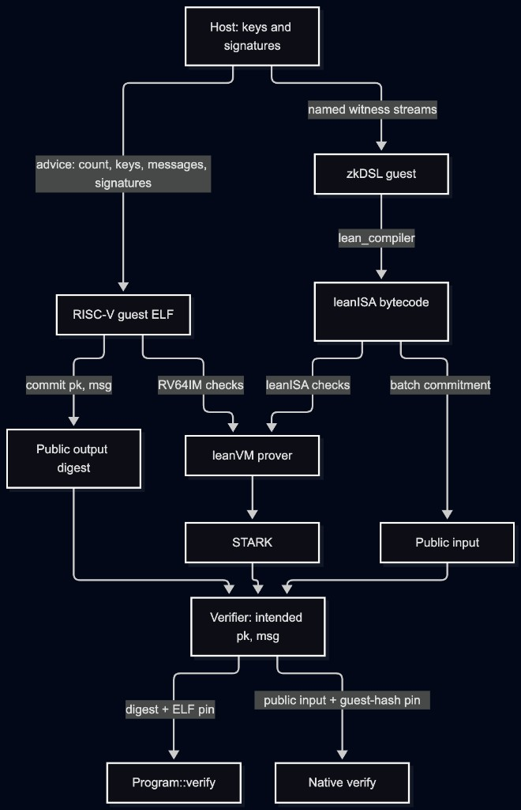
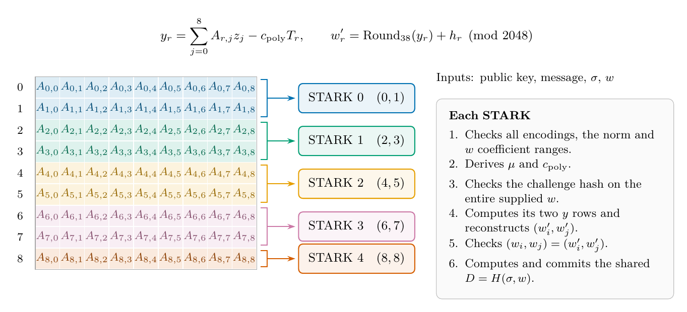
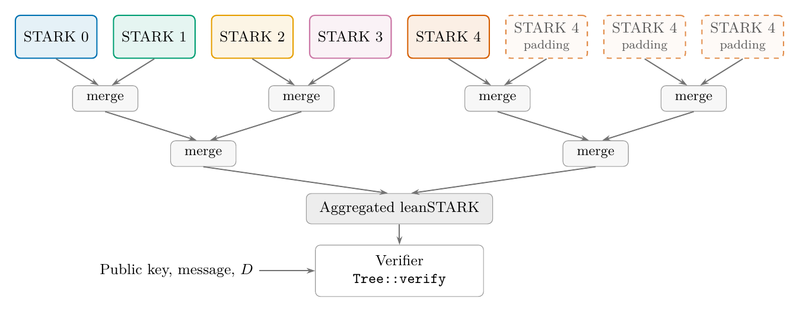
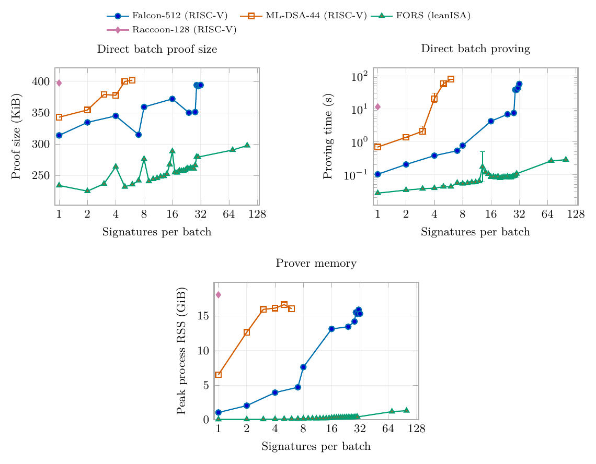
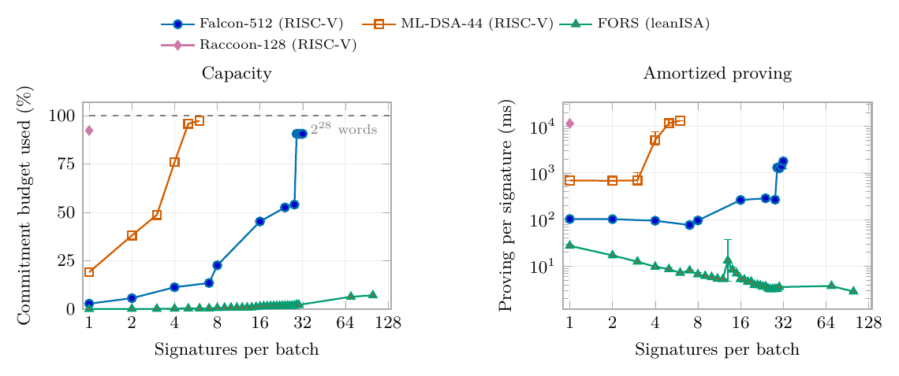
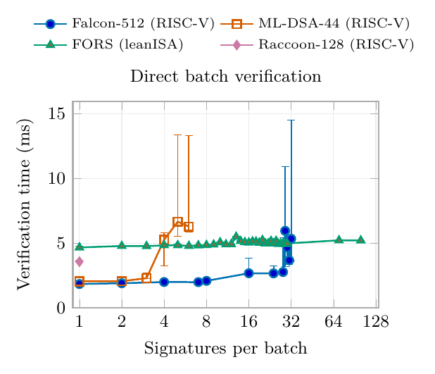
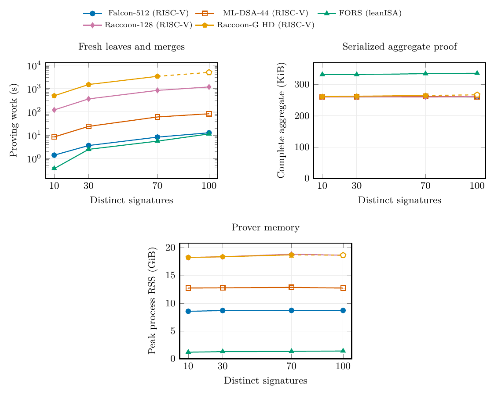
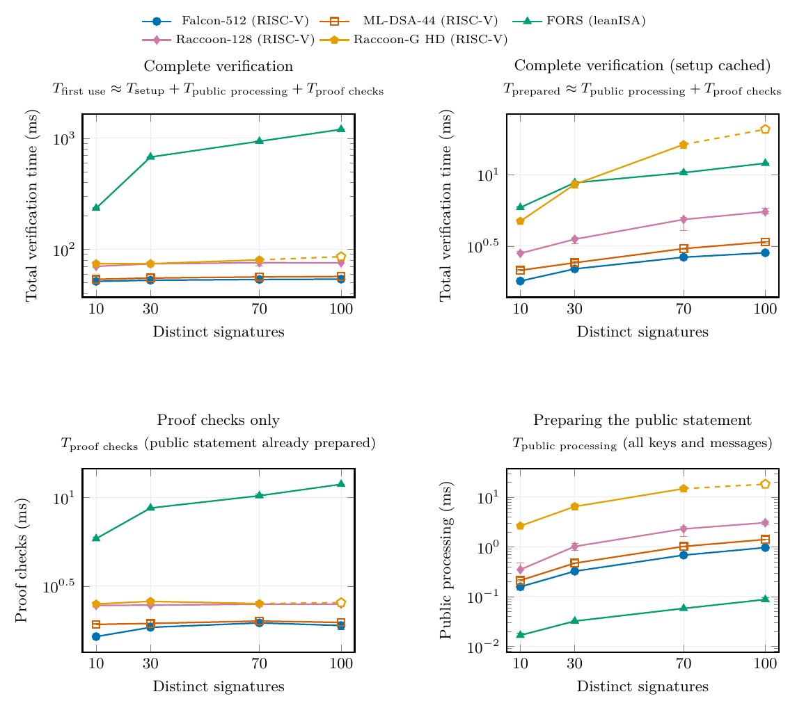
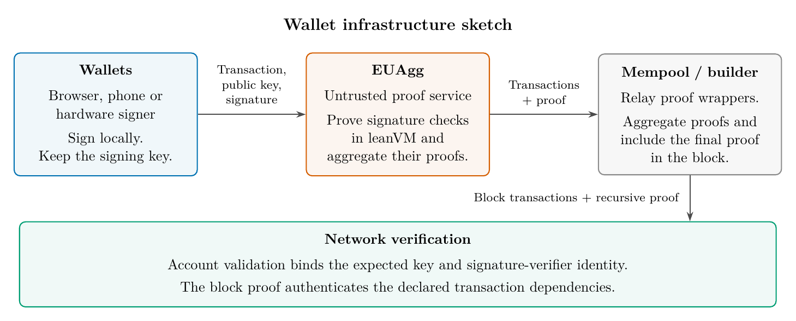

# Motivation

Nowadays, the wallet ecosystem contains a plethora of features depending on different security models. These features require classical signatures to support threshold signing, key derivation or implementations that fit hardware signers. These properties are not generically present in post-quantum signature schemes; however, some proposed schemes do support them. Examples include [Efficient Threshold ML-DSA](https://www.usenix.org/system/files/conference/usenixsecurity26/sec26_prepub_celi.pdf), [Threshold Raccoon](https://csrc.nist.gov/presentations/2024/threshold-raccoon), [Falcon on Ledger Nano S+](https://github.com/ZKNoxHQ/ZKNOX-HW-FALCON), and [Raccoon-G HD wallets](https://eprint.iacr.org/2026/380), which support public child-key derivation for watch-only wallets.

Ethereum is following a hash-based approach which generically lack the ability to directly support these different use-cases. Nonetheless, the conjunction between [EIP-8141](https://eips.ethereum.org/EIPS/eip-8141) and [EIP-8288](https://eips.ethereum.org/EIPS/eip-8288) provide a very agile path to support different signature schemes for wallets according to their needs. [EIP-8141](https://eips.ethereum.org/EIPS/eip-8141) proposes programmable account validation, while [EIP-8288](https://eips.ethereum.org/EIPS/eip-8288) proposes recursive STARK aggregation of signature and proof dependencies. Together, these drafts could let wallets choose their signing scheme while the network verifies a common proof. 

In this post, we run five different signature schemes (Falcon-512, ML-DSA-44, FORS, Raccoon-128 and Raccoon-G) under a STARK proof and measure the proving, proof-size and verification costs of that approach.

# Implementation

You can check this (experimental) implementation [in this repository](../README.md). Falcon, ML-DSA and both Raccoon variants use leanVM's experimental `riscv-exploration` branch, pinned to [`06e5c9cd6981103786f9d0a17324241b559a50d3`](https://github.com/leanEthereum/leanVM/tree/06e5c9cd6981103786f9d0a17324241b559a50d3). Falcon reuses the implementation introduced by [PR #490](https://github.com/leanEthereum/leanVM/pull/490). On the other hand, FORS uses the [Python leanISA guest](../leanISA/guests/fors.py) at [`575df819d9c857f38068cecf7b1640e0ce4bfb29`](https://github.com/leanEthereum/leanVM/tree/575df819d9c857f38068cecf7b1640e0ce4bfb29). As per the current state, FORS achieve better performance with its specialised Keccak circuit.

Both RISC-V and leanISA based implementation follow the approach supported by leanVM summarized in the digram below.

*Figure 1: leanVM proof possible flows (RISC-V left branch and leanISA right branch).*

All four signature (Falcon, ML-DSA, FORS and Raccoon-128) verification mechanism fit inside one leanSTARK proof. However, Raccoon-G verification exceeds leanVM's commitment cap: approximately 839 million witness words against a limit of 268 million. We explore next the approach taken to create a leanSTARK proof of one Raccoon-G signature verification mechanism. 

## Raccoon-G verification approach

The Raccoon-G verification mechanism follows the original Raccoon process described in Algorithm 3 of [[PKPR24]](https://eprint.iacr.org/2024/1291.pdf). The expensive step is step 4 which can be summarized as:

$$y := A\cdot z - c_{poly}\cdot T, \tag{1}\label{eq:full}$$

where $A$ is a $9\times 9$ matrix of polynomials, $z$ is a signature components, $c_{poly}$ is its challenge polynomial, and $T$ is a rounded and scaled public-key vector. The verifier, in step 5, computes the commitment vector $w':= \text{Round}(y) + h$, using the signature hint $h$, and then reconstructs  $c'_{hash}=\mathsf{ChalHash}(w', \mu)$. Here $\mu$ binds together the full public key and message and $c_{hash}$ is the signature’s challenge digest. 

### Multi-STARK verification

As mentioned before, the whole signature verification process exceeds leamVM's commitment cap, making it impossible to directly fit into one leanSTARK proof. Therefore, we focus on splitting the verification method into different leanSTARK proofs, which are then aggregated in a final leanSTARK.

Since the most expensive element is step 4 from [[PKPR24], Alg. 3](https://eprint.iacr.org/2024/1291.pdf), we split the $y$ computation $\eqref{eq:full}$ in 5 sets of matrix rows and individually prove the rows relation in one leanSTARK. More specifically, for matrix row $r$ given by

$$  y_r=\sum_{j=0}^{8}A_{r,j}\cdot z_j-c_{poly}\cdot T_r, \tag{2}\label{eq:row}$$

we create five proofs check rows: $(0,1), (2,3), (4,5), (6,7)$ and $(8,8)$. Each leaf leanSTARK proof receives from the prover the whole signature $\sigma$ and the proposed commitment vector $w$. Then, inside leanVM, each instance runs all steps from [[PKPR24], Alg. 3](https://eprint.iacr.org/2024/1291.pdf) but step 4 and 5. Instead, it:

1. Reconstructs the two rows according to $\eqref{eq:row}$ and get $(w'_i, w'_j)$;
2. Checks equality with the corresponding supplied $w$ rows, i.e., $(w_i, w_j) == (w'_i, w'_j)$.

Moreover, to tie the leanSTARK proofs together, and to ensure different proofs do not use different witnesses pairs $(\sigma, w)$, each proof computes a binding element $D = H(\sigma, w)$ which needs to be passed to the verifier. Figure 2 summarizes this first process.

*Figure 2: Matrix split structure and STARK proof elements.*

After creating all 5 STARK proofs, these are aggregated together in a Merkle tree type fashion as depicted below in Figure 3. We combine the parts through leanVM’s native binary recursion circuits. So, for one signature, five fresh proofs occupy eight padded leaf slots, repeating the final proof for padding.

The receiver the is able to reconstruct all five expected outputs from its intended public-key/message pair and the prover's untrusted $D$, then performs complete `Tree::verify`. This checks the root, ordered outputs and all remaining polynomial claims, without the need to see the signature $\sigma$ and the intermediate commitment $w$.

*Figure 3: Aggregation of multiple leanSTARK proofs into a final leanSTARK proof.*

# Experimental results

In this section, run some experiments to check the performance for proof generation and verification of alternative signatures under leanVM. We start by exploring single STARK proof generation for batched signatures and then check the impacts and limitations of having 10, 30, 70 and 100 distinct signatures for each of the five categories implemented (Falcon-512, ML-DSA-44, FORS, Raccoon-128 and Raccoon-G). 

The machine used to host the experiments was an Apple M4 Pro with 24 GiB RAM. Direct batches use three measured proofs after one warmup. Recursive points use three fresh complete pipelines in separate processes, without an in-process proving warmup; Raccoon-G at 100 signatures has one completed run. Bars shown in the figures depict the full range. Also, we monitor the process-lifetime memory peak (RSS, Resident Set Size), including setup and warmup.

## Direct batches

We start by checking how many signatures can be batched together in a single STARK. It verifies every signature and commits to the ordered keys and messages. As described in Figure 1 above, the verifier then needs to derive the expected commitment from its own intended public records, checks the approached program and proof parameters. In this section, we omit Raccoon-G because it requires more than one STARK proof for one signature proof verification. 

### Prover

*Figure 4: Direct-batch proving costs under leanVM. Proof size (top left), proving time (top right), and peak prover memory (bottom) as the batch grows.*

As we can see in the above figure, for the four alternative signatures analyzed, we were able to batch together **32 Falcon**, **6 ML-DSA**, **1 standard Raccoon** and **(at least) 100 FORS signatures**. These are the successful batch sizes for the measured implementations and input prefixes, not universal scheme limits. A [separate capacity recheck](../risc-v/results/reaudit/README.md) proved 33 Falcon signatures with the unchanged guest on another input window, and seven ML-DSA signatures with a separately identified storage optimization. Those controls are excluded from the timing curves. The observed boundaries are related to the committed witness cap at $2^{28}$ words as depicted below in Figure 5.

*Figure 5: Witness capacity and proving cost per signature under leanVM. The left panel shows the fraction of the $2^{28}$-word witness budget used; the right shows proving time divided by batch size.*

It is interesting to observe that the largest batch is not always the best operating point. Falcon's witness jumps from about 145 million words at 28 signatures to 243 million at 29. This also justifies the the proving per signature jump as shown in Figure 5. The same jump applies to ML-DSA-44 between 3 and 4 signatures.

FORS instead benefits from specialised Keccak: its 100-signature batch uses only 19.4 million words and a 298.02 KiB proof, below its 450 KiB signature payload.

### Verifier

Below, we measure complete direct-proof verification and exclude public claim derivation, setup and file reads.

*Figure 6: Direct-batch STARK verification time under leanVM as the number of signatures increases.*

## Recursive trees

Now, we cover STARK trees containing 10, 30, 70 and 100 original signature verification procedures. Each leaf proves a small signature verification workload and we selected a binary tree with the following leaf structure:

| Workload | Work per leaf | 
|---|---|
| Falcon, RISC-V | 10 signatures | 
| ML-DSA, RISC-V | 2 signatures | 
| FORS, leanISA | 5 signatures | 
| Raccoon, RISC-V | 1 signature | 
| Raccoon-G, RISC-V | 2 matrix rows | 

### Prover

*Figure 7: Recursive STARK aggregation under leanVM: complete-tree proving work (left) and aggregate size (right). Points show medians of three runs, except Raccoon-G at 100 signatures, which shows one completed run. Error bars show the range. Sizes exclude public keys and messages.*

The four RISC-V implementations end with the same native recursion machinery and the root proves verification of child proofs using a common recursion-circuit family. Its size therefore depends mainly on that root circuit and its proof parameters. Consequently, different signature algorithms require very different proving work while producing similarly sized roots.

On the other hand, FORS uses a different backend and recursive construction: leanISA verifier wrappers with the sumcheck reduction. Its final pack contains 333.13 KiB of root proof and 2.84 KiB of auxiliary data. Most of the difference therefore comes from the root proof construction, which is an implementation difference and not an inherent requirement that FORS aggregates be larger.

For each signature scheme, peak RSS remains roughly constant across the tested signature counts. Leaf batches and recursive merges are proved sequentially, allowing working memory to be reused as the tree grows. Consequently, although these measurements cover the complete proof pipeline, the peak memory usage is very similar to that of proving a single leaf.

### Verifier

The verifier receives a receipt which contains the root STARK plus any auxiliary data required to verify it, such as Raccoon-G's witness bindings or FORS's remaining polynomial claims. So, the verifier performs three kinds of work which we presente in Figure 8 below:

$$
\begin{aligned}
T_{\text{first use}} &\approx T_{\text{setup}}+T_{\text{public processing}}+T_{\text{proof checks}},\\
T_{\text{prepared}} &\approx T_{\text{public processing}}+T_{\text{proof checks}}.
\end{aligned}
$$

***Program setup*** ($T_{\text{setup}}$) means loading or compiling the approved programs and preparing verification tables and recursion circuits. FORS has substantially more preparation work in this implementation, explaining much of its high top-left curve in Figure 8.

***Public processing*** ($T_{\text{public processing}}$) answers: "Does this proof concern the transactions I intend to accept?"

The verifier processes every original public-key/message pair, constructs the expected leaf commitments, and accounts for ordering and padding. For Raccoon-G, it constructs five part claims per signature using the same supplied $D$. This is the crux as a cryptographically valid proof for a different set of transactions would not authorize the intended transactions.

***Proof verification*** ($T_{\text{proof checks}}$) answers: "Is that statement correctly proved?"

Figure 8 bottom-left panel includes the root STARK and all remaining verifier obligations. It is not just a check of the root transcript.

For RISC-V, complete `Tree::verify` checks the recursive proof and settles its remaining program, memory and circuit claims. For FORS, it checks the root STARK and evaluates the remaining reduced program claims. At 100 signatures, FORS has five such final evaluations.

*Figure 8: Recursive STARK verification under leanVM. Top: complete verification including program setup (left) and with setup cached (right). Bottom: complete proof checks (left) and preparation of the public statement from all keys and messages (right).*

# Wallet infrastructure discussion

EIP-8288 opens the ability to integrate more complex cryptographic verification flows off-loading work from the EVM to off-chain proof computation. This makes it possible to integrate alternative signatures in wallet flows. 

**Memory constraints.** If wallets generated their own leanSTARKs, proving would be a significant obstacle on browsers, phones and hardware signers. A conventional wasm32 build can address at most 4 GiB in one linear memory, and allocations can fail earlier when RAM is scarce. Memory64 increases the addressable range where supported, but provides no additional RAM. In Figure 4's single-signature measurements, only Falcon-512 and FORS have native peak RSS below 4 GiB. These are plausible browser candidates, but larger batches or recursive proving can require much more memory.

**A possible flow.** The wallet signs locally and sends the transaction, public key and signature to an external untrusted aggregator (EUAgg), while (of course) its signing key stays on the device. The EUAgg then proves signature verification under leanVM and forwards the transactions and proof bundle to the mempool, where builders can aggregate them further. The network checks the final proof against the declared dependencies, while account validation requires the expected verifier, authorized key and signed transaction. Check Figure 9 for a diagram view of the flow.

*Figure 9: Wallet infrastructure sketch with off-chain leanSTARK generation and aggregation.*

This structure keeps proving off the wallet and lets users share proving costs. We note that EUAgg can delay or refuse service, but transaction authorization remains enforced by the account policy and proofs.

**EIP-8288.** This flow needs the draft's generic STARK path to be completed and `LEANSTARK_SCHEME` is currently reserved and invalid in dependency frames. Also, `AGGREGATED_VK` and `DEPS_HASH` remain `TBD`. Integration must define the proof format and parameters, and bind each dependency to the signature-verification program, public key and transaction hash. The account's validation logic must require that exact claim. Also, the draft sets `MAX_LEANSTARK_DEPS_PER_WRAPPER=1`, so a same-verifier batch that produces many individual proven dependencies therefore needs revised wrapper/admission limits and specified generic semantics. This would follow the [same-verifier batching suggestion in the EIP-8288 discussion](https://ethereum-magicians.org/t/eip-8288-frame-type-for-pq-sig-and-stark-aggregation/28723/14).
