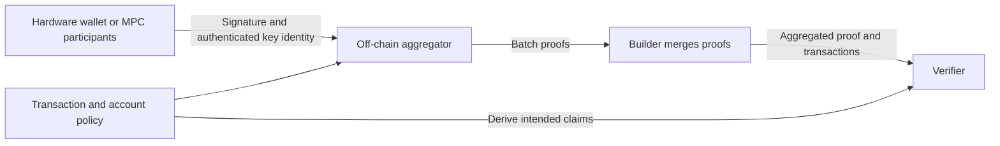
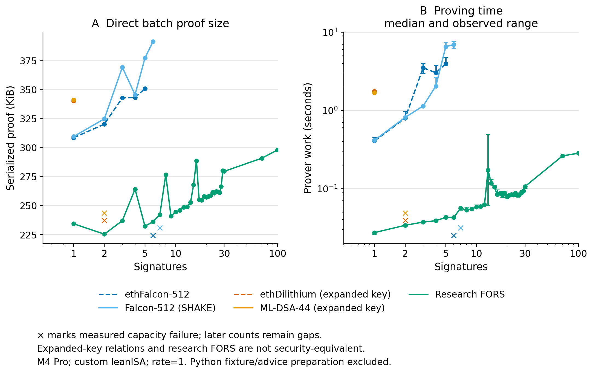
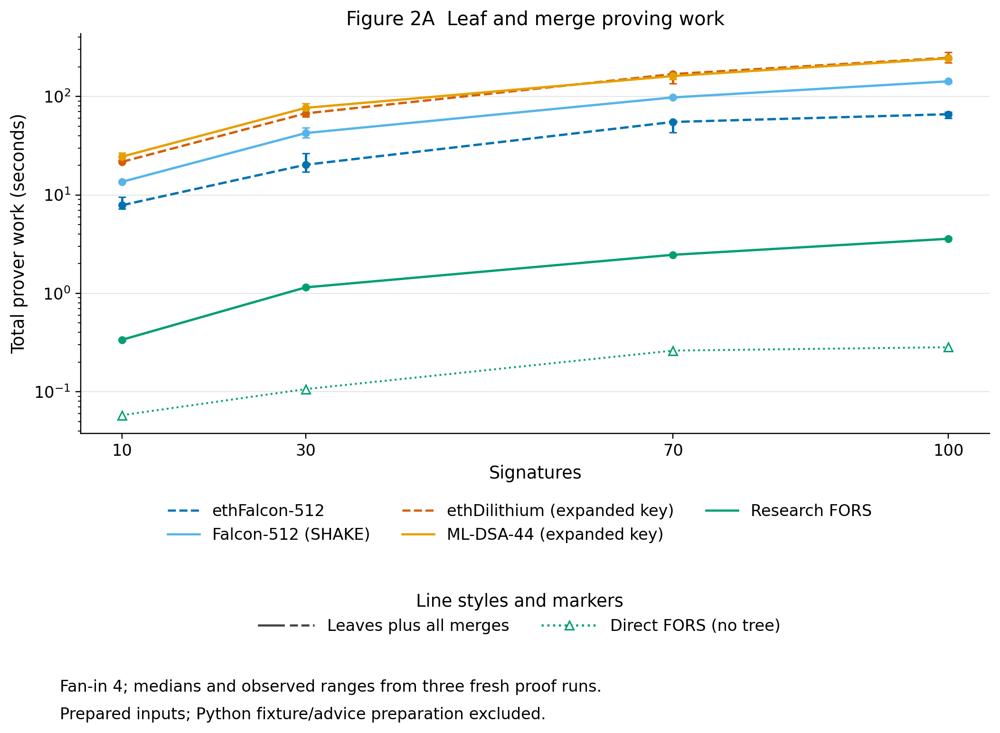
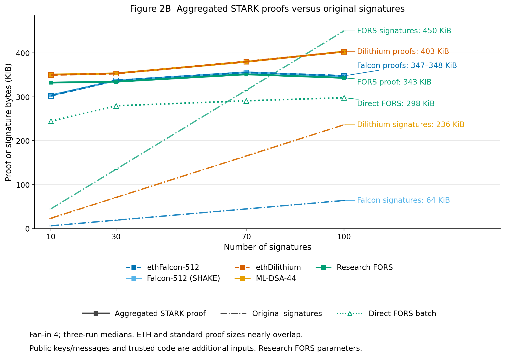
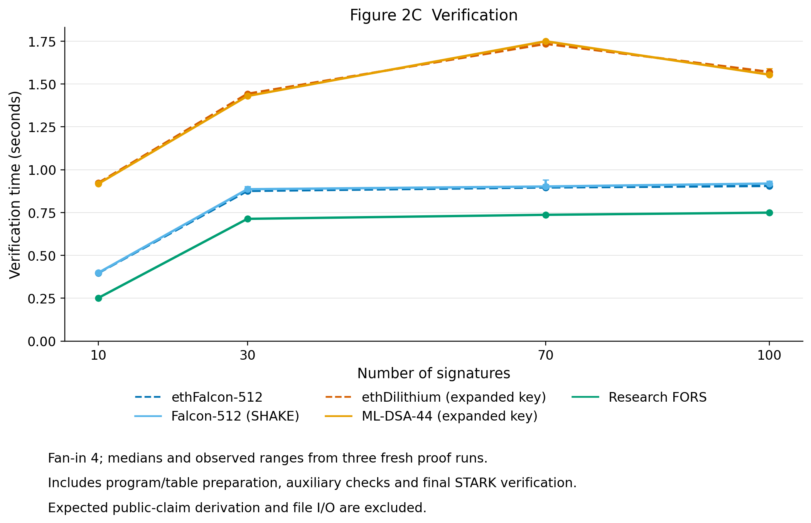
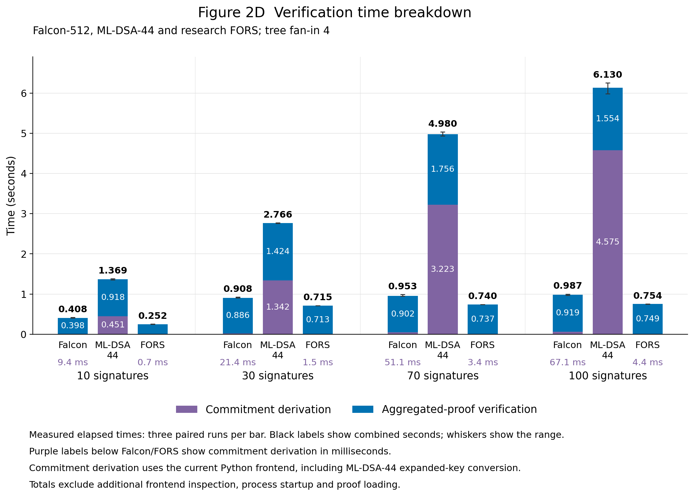
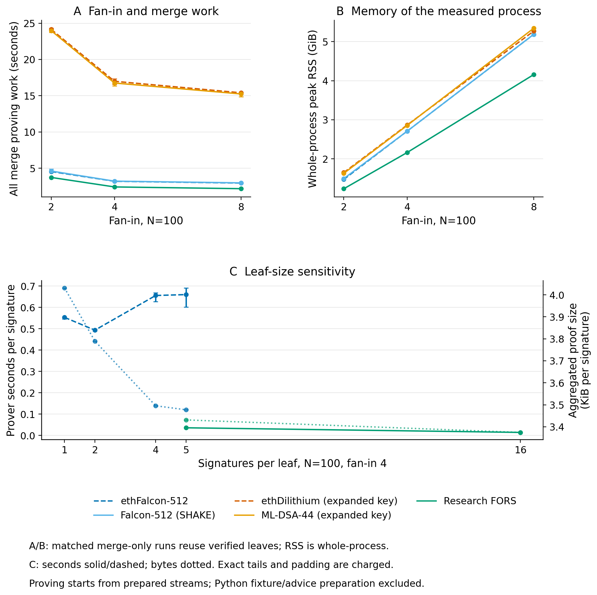
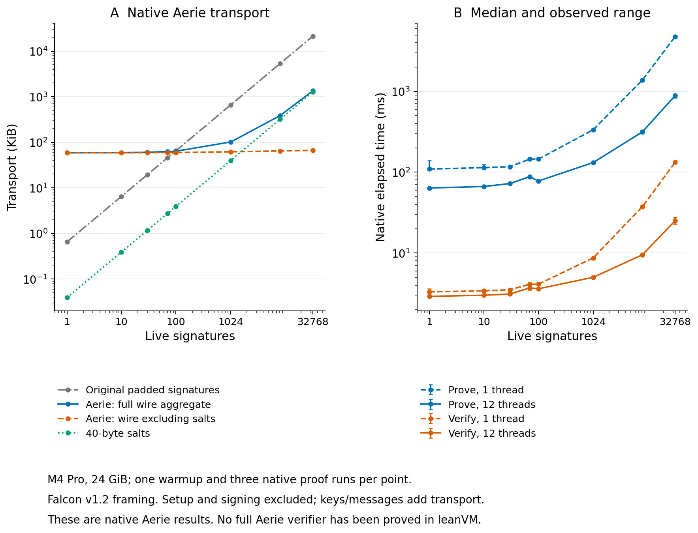

# Signature choice behind leanVM aggregation

Wallets should choose a post-quantum signer suited to their hardware or threshold protocol. The network can verify a common proof format. We measure this separation's computation and transport costs, including proof merging.

This experiment follows the [recursive mempool proposal](https://ethresear.ch/t/recursive-stark-based-bandwidth-efficient-mempool/23838) and [signature merging work](https://ethresear.ch/t/signature-merging-for-large-scale-consensus/17386). It also tests the direction of [zsfelfoldi's reply #14](https://ethereum-magicians.org/t/eip-8288-frame-type-for-pq-sig-and-stark-aggregation/28723/14): batch several dependencies that share a verifier before recursion, so users need not produce a separate STARK for every signature. Our code measures that computational building block. It does not yet implement the proposed dependency interface.

We compare five relations on one pinned leanVM revision: ethFalcon-512, standard round-3 Falcon-512 with SHAKE256, ethDilithium, ML-DSA-44 with SHAKE, and standalone research FORS. Standard variants target existing MPC/hardware compatibility; ETH variants test Keccak adaptations; FORS contrasts hash-heavy verification with prime-field lattice arithmetic on a binary-field VM. The ETH variants replace SHAKE streams with a Keccak counter construction. Native standard inputs use [FIPS 204](https://csrc.nist.gov/pubs/fips/204/final) ML-DSA-44; the guest proves an expanded-key relation. Vendored “Dilithium2” names do not denote round-3 Dilithium2. SHAKE uses the existing permutation with its own padding, rate and squeezing.

Our runs use the same custom leanISA. [PR #490](https://github.com/leanEthereum/leanVM/pull/490), on the RISC-V exploration branch, reports 28 standard Falcon signatures in 1.902 seconds (±0.8%) with a 355.5 KiB proof on an AMD 9950X3D using 32 threads. Those published measurements were not rerun here. ISA, in-guest decoding and hardware differ, precluding a speedup ratio. Here, Falcon witnesses contain expanded coefficients. Compact decoding happens before proving; the VM checks the signature equation, hash-to-point, ranges and norm. Our capacity limits therefore describe this implementation.

Both Dilithium-family guests authenticate an expanded matrix/vector/key-hash encoding of 81,984 bytes. This is internal witness encoding; a wallet can upload the compact 1,312-byte key. The guest does not prove compact-key expansion. Verifiers derive that identity from an independently authorized compact key or trust validated registration. Our frontend derives it outside the VM and records that native cost. Both hash variants use this boundary; proving expansion inside the VM remains separate work.

FORS is a few-time component with parameters n=32, k=16, a=8, using 4,608-byte signatures. It is neither full leanSPHINCS nor SLH-DSA. Its deterministic message-index map also permits a generic chosen-message birthday strategy around 2^64 hashes. Its small proving cost must not be read as equivalent security or unlimited-use wallet support.

The tree is deterministic. Ordered leaves contain distinct key/message claims. Each parent proves verification of its child proofs. The main comparison uses five signatures per Falcon or FORS leaf, one per Dilithium-family leaf, and fan-in four, at totals 10, 30, 70 and 100. Partial leaves contain the exact remainder. Standard Falcon directly fits six signatures, but the paired tree comparison keeps both Falcon leaf sizes at five. Wrapper code specializes to the complete static plan, including its expected claims. Leaf proofs can be reused; merge subtrees cannot yet be carried between changing mempool plans.

There is an explicit recursion cost beyond the root proof. The upstream verifier defers a child-bytecode polynomial evaluation. We retain the point for every tree edge. The Verifier evaluates each obligation against trusted code, reconstructs node statements from the leaves upward, then verifies the root. Full 192-bit coordinates and values enter those statements. One final proof replaces child proof files, but auxiliary bytes and native evaluation work grow as O(E), where E is the number of tree edges. This is bounded-depth recursion with explicit obligations, not constant-cost unlimited-depth recursion.

The intended wallet flow is:

In that architecture, signers approve the canonical transaction digest. An aggregator receives the public signature and builds witnesses; it needs no signing key. Verifiers derive the intended messages and authorized keys themselves. A proof of a different valid claim list supplies no authorization for these transactions. Our benchmarks use synthetic 32-byte messages; transaction canonicalization and account-policy validation remain integration work.

This separation matters for constrained clients. [Threshold ML-DSA](https://www.usenix.org/system/files/conference/usenixsecurity26/sec26_prepub_celi.pdf) and [threshold Falcon](https://eprint.iacr.org/2026/1300) research produces signatures compatible with standard verification. That compatibility does not automatically carry over to a changed ETH hash function. Hardware prototypes such as [ZKNOX-HW-FALCON](https://github.com/ZKNoxHQ/ZKNOX-HW-FALCON) and [ZKN-PRIVACYHW](https://github.com/ZKNoxHQ/ZKN-PRIVACYHW) also motivate separating signing and proving, subject to their development limitations. We have not tested signatures from these MPC protocols or devices with our guests. Our Falcon is round-3 Falcon, not FN-DSA.

On this host, median native signing takes 1.851/1.860 ms for ETH/standard Falcon and 0.258/0.141 ms for ethDilithium/ML-DSA-44, over 30 fresh samples each. One standard Falcon proof takes 0.415 seconds and 2.505 GiB process RSS. Its 317,040-byte individual proof contains 486 times as many bytes as its 652-byte signature; both exclude shared key/message/transaction overhead. ML-DSA's proof takes 1.686 seconds and 8.720 GiB. Python fixture/advice preparation is additional. Offloading moves proving requirements to the service. These are desktop results, not phone, browser, battery, secure-element or MPC benchmarks.

Figure 1 shows direct batching: leanVM verifies several signatures in one execution, and the prover produces one STARK covering the entire batch. These runs do not combine existing proofs or use recursion. The left panel shows the resulting proof size; the right panel shows the time needed to produce it.

Proof size does not grow smoothly with the number of signatures. The proof is compressed evidence of the whole execution. Internally, leanVM groups and pads execution data into blocks, and its proof format can omit some redundant authentication data. Changes in these layouts can produce steps and occasional decreases in the encoded proof size. A smaller proof still covers every signature in the batch.

The largest batches we successfully proved contained five ethFalcon signatures, six standard Falcon signatures, and one signature for each Dilithium-family guest. In each case, trying one more signature exceeded the backend's capacity for a single proof.

Producing a STARK first requires an expanded record of the computation, called the witness. It contains intermediate values from signature verification, plus extra data used to check arithmetic and memory accesses. Each signature adds many such entries. Falcon and Dilithium are costly here because their modular arithmetic must be expressed through additional checks in leanVM's binary-field model.

The final proof contains compact commitments and cryptographic checks of this record, rather than the record itself. Consequently, it can stay a few hundred KiB while the witness grows very large. This backend supports internal commitments only up to a size of 2^28 words. The next tested batches exceed that supported size, so the code rejects them before producing a proof. Supporting larger witnesses requires changes to the commitment parameters and verifier as well as the prover; more RAM alone does not remove this limit.

These measured limits describe these verifier programs and this leanVM revision; they are not fundamental limits of the signature schemes. Below, we handle larger totals by splitting signatures into smaller batches and recursively combining their proofs.

The research FORS guest needs less proving work per signature and also succeeds with direct batches of 70 and 100 signatures. We did not establish its maximum batch size. Crosses mark batch sizes that we tested and that failed. Blank regions beyond those failures contain no measurements: we did not estimate proving times or proof sizes for larger, untested batches.

The projected size break-even is **about 205 signatures for ethDilithium/ML-DSA-44** and **667 for the Falcon family**, using a 666-byte padded Falcon-512 signature. To estimate it, let $N$ be the signature count, $C$ the fixed proof component, $a$ the auxiliary verification bytes added per signature, and $s$ the size of one original signature. All sizes below are in bytes:

$$
P(N)\approx C+aN,\qquad R(N)=sN,
\qquad P(N)<R(N)\;\Longleftrightarrow\;N>\frac{C}{s-a}
\quad(s>a).
$$

For this four-child tree, with $b$ signatures per leaf, there are approximately $N/b$ leaves, $N/(3b)$ merges and $4N/(3b)$ edges. Each edge adds 536 bytes of deferred-check data and its length field; each merge adds another 8-byte length field. Thus:

$$
a\approx\frac{4\times536+8}{3b},\qquad
a_{\mathrm{Dilithium}}\approx717.33\;(b=1),\qquad
a_{\mathrm{Falcon}}\approx143.47\;(b=5).
$$

Taking $C=340\,\mathrm{KiB}=348{,}160$ bytes, $s_{\mathrm{Dilithium}}=2{,}420$ and $s_{\mathrm{Falcon}}=666$ gives:

$$
\begin{aligned}
N_{\mathrm{Dilithium}}&>\frac{348{,}160}{2{,}420-717.33}\approx204.5
&&\Rightarrow\;205\text{ signatures},\\
N_{\mathrm{Falcon}}&>\frac{348{,}160}{666-143.47}\approx666.3
&&\Rightarrow\;667\text{ signatures}.
\end{aligned}
$$

The **666-byte** baseline is the [fixed padded Falcon-512 encoding](https://falcon-sign.info/impl/falcon.h.html). Figure 2B retains the actual variable-length benchmark signatures, averaging about 655 bytes each. Varying $C$ from 330 to 350 KiB moves the model's first saving count to approximately **199–211 Dilithium signatures** or **647–686 Falcon signatures**. These are projections beyond our 100-signature measurements; actual proofs near these counts are needed to confirm them. Public keys, messages and program distribution are excluded from this size comparison.

Figure 2C measures verification of the aggregated STARK proof. The Verifier starts with the intended public key/message pairs and the approved verifier programs. It independently derives the expected leaf commitments, completes the auxiliary checks against trusted code, reconstructs the expected root statement, and verifies the root STARK against that statement and program. Acceptance establishes that a valid signature exists for every intended key/message pair under the implemented signature relation. Changing a key or message changes the expected statement, so the original proof will fail verification.

The plotted time includes preparing the tree programs and verification tables, completing the auxiliary checks and verifying the final STARK. Deriving the expected public claims and loading files are outside the timed interval. For the Dilithium variants, the Verifier derives the expanded-key identity from the compact public key during that earlier claim-derivation step, outside the STARK.

Figure 2D shows measured verification work for **10, 30, 70 and 100 signatures**. Each cluster contains Falcon-512, ML-DSA-44 and research FORS. Purple is the Verifier's computation of the public key/message commitments, including compact-key expansion for ML-DSA-44 in the current Python frontend. Blue covers program preparation, auxiliary checks and final STARK verification. **Both components are timed operations**; the labels above the bars give their combined time in seconds.

Small purple labels below Falcon and FORS give the commitment-derivation times in milliseconds, since those segments are too small to label inside the bars.

The large ML-DSA-44 derivation cost comes mainly from the current Python implementation of the guest's key representation. Each compact key expands into 5,120 coefficients, which are converted into the guest's binary-field encoding and serialized into 81,984 bytes before hashing. A [10-key diagnostic profile](../results/article/mldsa-commitment-diagnostic.json) attributes about 90% of key-identity time to that coefficient conversion and about 6% to compact-key expansion. The broader preparation timer also includes repeated leaf-program source generation. These timings characterize the prototype's preprocessing; an optimized native implementation needs a separate benchmark.

Each bar shows the median combined time of three paired runs, with both components taken from that same run. Additional frontend inspection, process startup and proof loading remain outside these two-phase totals. [Measured component timings and source reports](../results/article/figures/verification-phases.csv).

To compare verification work at the projected size break-even counts, we estimate sequential signature verification as $T_{\mathrm{signatures}}(N)\approx N\,t_{\mathrm{signature}}$, using the measured per-signature baselines. The same size model gives approximately 78 signatures for research FORS, using 4,608-byte signatures and about 119.47 auxiliary bytes per signature in the tree.

| Scheme | Projected size break-even, signatures | Original signatures at that count, ms (estimated) | One STARK for 100 signatures, ms (measured) |
|---|---:|---:|---:|
| ethFalcon-512 | 667 | 9.11 | 905.33 |
| Falcon-512 | 667 | 6.38 | 919.42 |
| ethDilithium | 205 | 20.31 | 1570.49 |
| ML-DSA-44 | 205 | 7.59 | 1554.51 |
| Research FORS (Python) | 78 | 39.29 | 749.45 |

The STARK column uses the existing 100-signature trees. STARK verification at the projected crossover counts has not been measured, so the table does not establish a same-count comparison there. Native totals are linear projections from repeated verification of one saved record per scheme; the lattice baselines use C, while FORS uses a Python/PyCryptodome reference. The STARK timings include program preparation and all auxiliary checks, with public-claim derivation and file I/O excluded as above. A bandwidth break-even point alone does not establish a CPU-verification advantage. [Calculation inputs and scope](../results/article/verification-size-break-even.json).

Figure 2 separates leaf-plus-merge proving work, transport size and verification. Figure 2B compares the aggregated STARK proofs with direct FORS batching and the original signature bytes. We use the terminology of [EIP-8288](https://eips.ethereum.org/EIPS/eip-8288#recursive-stark-header-entry); the measured aggregated proof size includes the root STARK, all auxiliary verification data and serialization metadata. Main points use three fresh proving runs from prepared inputs. At N=100, no lattice aggregate beats raw signature bytes: roughly 64 KiB for Falcon and 236.3 KiB for either Dilithium-family variant. FORS reduces its 450 KiB signature payload under these research parameters. Public claims and shared code add transport costs. The earlier flat six-to-one experiment remains a separate reference.

Figure 3 A/B use matched merge-only runs with verified reusable leaves. For ethFalcon at N=100, fan-ins two/four/eight take 4.552/3.207/2.959 seconds and 1.474/2.708/5.187 GiB process RSS. Eight saves about 8% merge work over four while using 1.9 times the memory. Four is a reasonable tradeoff here. Leaf size two uses 49.342 s/4.817 GiB/378.96 KiB, versus five's 65.997 s/10.330 GiB/347.71 KiB. FORS leaf size 16 cuts its 100-signature tree work to 1.417 seconds; direct proving still wins at 0.283 s/298.02 KiB. Exact tails and minimum commitments are charged.

Aerie provides another aggregation layer: aggregate Falcon first, then prove its verifier in leanVM. We pinned [the existing Rust implementation](https://github.com/a16z/aerie/tree/49b6c212c209286c536196f53618823ffdf0e899) and measured native Falcon-512 aggregation on this M4 Pro. These use Falcon v1.2 padded signatures and key-prefixed SHAKE framing, so they are a different relation from our round-3 and ETH inputs.

| Signatures | Native prove, 12 threads, ms | Native verify, 1 thread, ms | Aggregate, KiB |
| ---------- | ---------------------------- | --------------------------- | -------------- |
| 30         | 72.3                         | 3.5                         | 60.30          |
| 100        | 77.7                         | 4.1                         | 63.61          |
| 1,024      | 131.7                        | 8.7                         | 101.81         |
| 32,768     | 888.7                        | 132.8                       | 1346.36        |

These are three-run medians, excluding signing and reusable setup. Wire bytes include 40-byte salts per signature; keys/messages are additional. We subsequently implemented the complete Aerie verifier on a separate leanVM RV64IM branch, including HashToPoint, the original BLAKE2b transcript, all sumcheck stages and the Akita opening. The guest accepts real aggregates for 1, 10, 30, 70 and 100 signatures. With validated public preprocessing compiled into its trusted ELF, full reference execution takes 2.321 to 2.853 seconds on this M4 Pro.

Actual outer proving fails at every tested count: even one signature requires a packed-witness lower bound 36.69 times the backend's `2^28`-word limit. Those execution times are not proving times, and no complete Aerie leanSTARK size or gas cost is available. The earlier constrained arithmetic probe remains a separate kernel benchmark. The [full Aerie study](aerie-under-leanvm.md) reports the implementation, preprocessing comparison, curves and guest rejection checks. Wrapping would retain the inner lattice assumptions.

[EIP-8141](https://eips.ethereum.org/EIPS/eip-8141) supplies account-defined validation. Its arbitrary signature bytes remain introspectable. [EIP-8288](https://eips.ethereum.org/EIPS/eip-8288) reserves generic leanSTARK dependencies and caps wrappers at one leanSTARK dependency and 16 leanSPHINCS dependencies. Generic per-item batches therefore require revised wrapper/admission limits and defined generic semantics. Reply #14's same-verifier batch must preserve individual claims: 30 transactions cannot be counted as one opaque unrelated dependency. Current mode-1 rules already require transaction/dependency equality. An extension needs a stable batch statement, code availability, and resource budgets for verified items, witness bytes and VM cycles, including invalid-witness admission. Shared prover-fee allocation is a separate proposal; current fixed dependency tariffs do not automatically fall when proofs share a batch.

The draft's one-second aggregation interval is a broadcast cadence; measured sequential work does not establish distributed latency.

Aggregators also see signature witnesses and can delay service. Availability, fallback submission and censorship resistance require a surrounding protocol. The current proofs are not zero knowledge. Native comparisons, SHAKE boundary tests and adversarial witness controls give evidence about the relation; they do not establish soundness of the whole compiler, memory argument or proof backend. The next target is a reusable online merge interface with folded bytecode obligations and canonical dependencies, measured under the same accounting.

The [methodology and reproduction commands](leanvm-signature-aggregation-methodology.md) and [checked primary references](leanvm-signature-aggregation-references.md) accompany the figure CSV/JSON files. This draft has not been posted externally.

### Wasm limitations

Browser proving must accommodate the prover's working memory, even when the final proof is small. Our native one-signature benchmarks reached peak resident RAM of [8.720 GiB for ML-DSA-44](../results/article/direct/mldsa-1.json), [2.505 GiB for standard Falcon](../results/article/direct/falcon-1.json), and [56.6 MiB for research FORS](../results/article/direct/fors-1.json). These are whole-process RSS measurements, including warmups and allocator effects. They indicate memory pressure, but do not establish the exact heap a Wasm implementation would need.

A conventional wasm32 build can address at most 4 GiB in one linear memory, and allocations can fail earlier when the device lacks available RAM. Memory64 allows larger addressing where the browser and toolchain support it, but does not provide extra physical memory. Consequently, moving this ML-DSA prover into a browser would require investigating memory reductions or a larger-memory build; compilation to Wasm alone would not establish feasibility. [WebAssembly memory limits](https://developer.mozilla.org/en-US/docs/WebAssembly/Reference/JavaScript_interface/Memory/Memory).

Falcon is a more plausible desktop-browser candidate, although a multi-GiB prover would leave limited headroom on memory-constrained devices. The much smaller FORS case is the clearest first browser experiment. Both still require a port and browser measurements: native timings and RSS cannot be carried over directly. Until those measurements demonstrate acceptable resource use, the architecture described above lets a browser or phone keep signing local while an off-chain aggregator handles proof generation.
