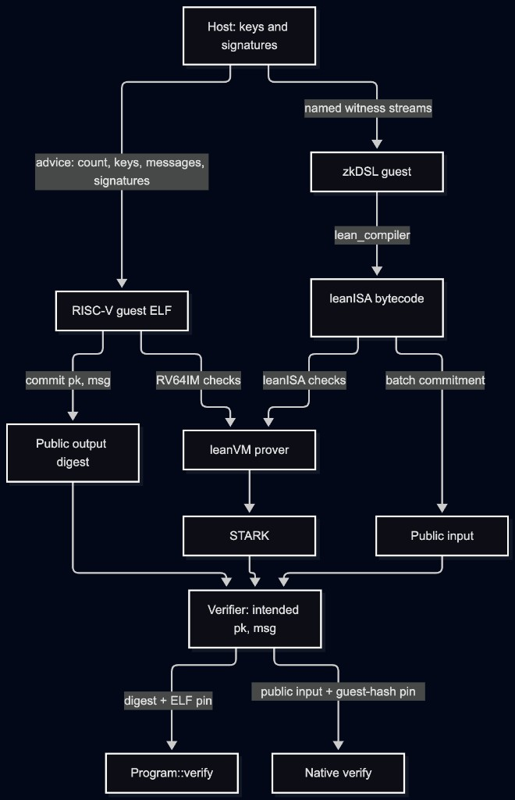
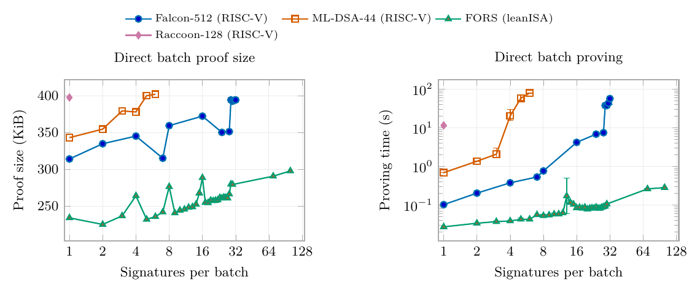
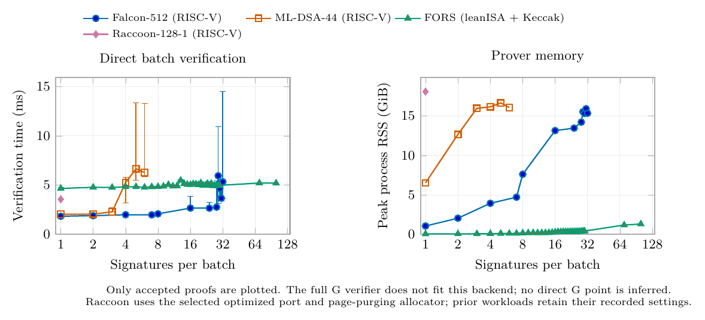
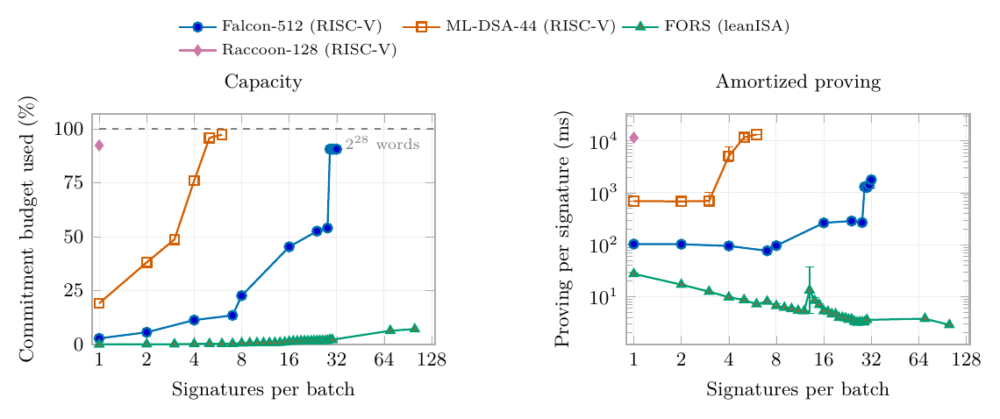
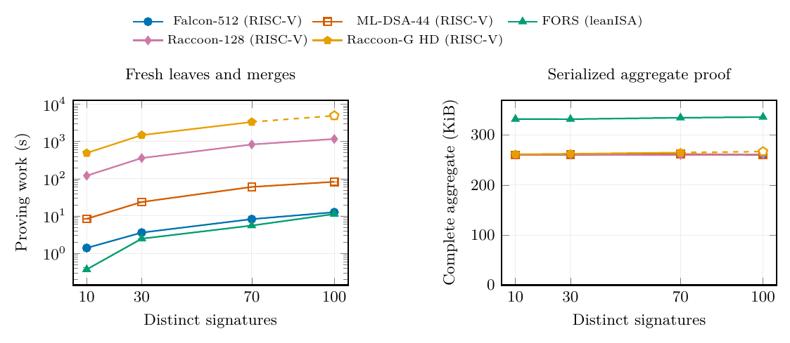
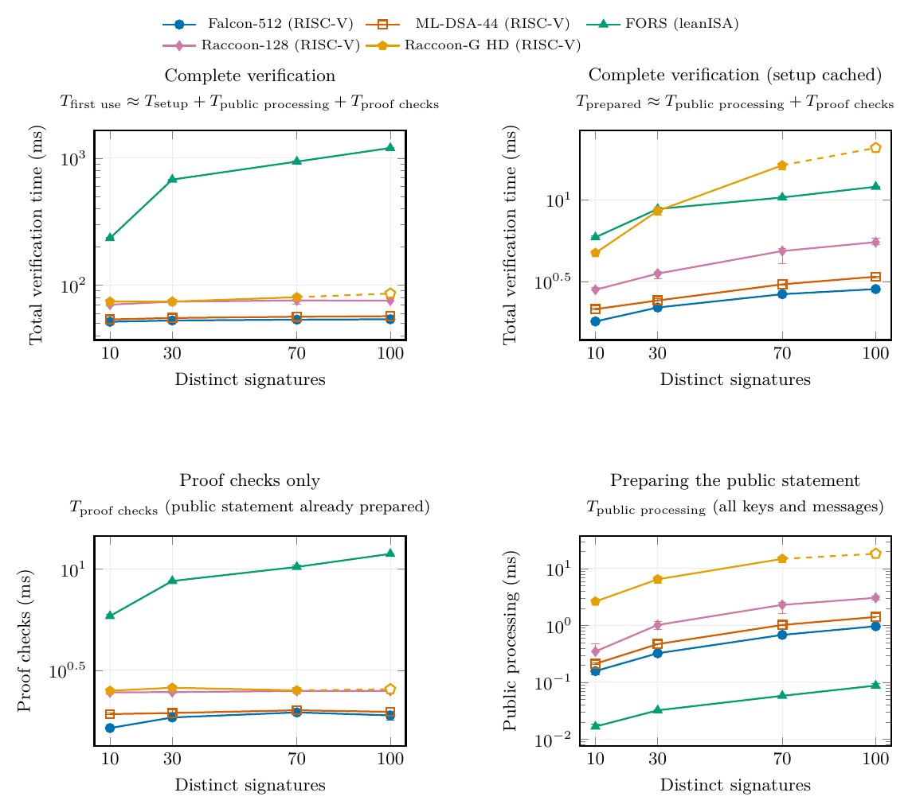
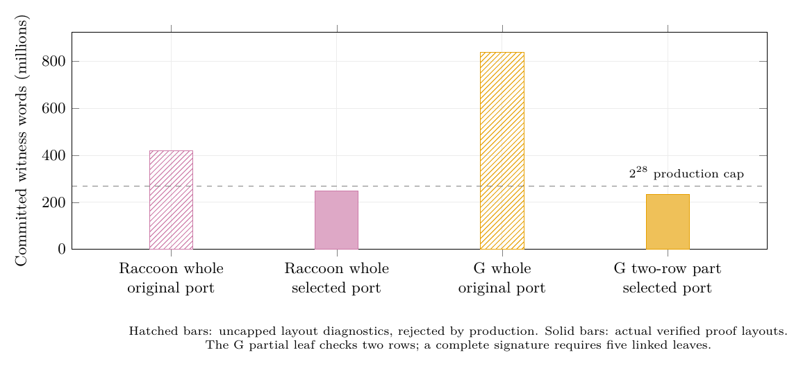

### Motivation

Post-quantum wallets need more than small signatures. They also need threshold signing, key derivation and implementations that fit hardware signers. Examples include [Efficient Threshold ML-DSA](https://www.usenix.org/system/files/conference/usenixsecurity26/sec26_prepub_celi.pdf), [Threshold Raccoon](https://csrc.nist.gov/presentations/2024/threshold-raccoon), [Falcon on Ledger Nano S+](https://github.com/ZKNoxHQ/ZKNOX-HW-FALCON), and [Raccoon-G HD wallets](https://eprint.iacr.org/2026/380), which support public child-key derivation for watch-only wallets.

[EIP-8141](https://eips.ethereum.org/EIPS/eip-8141) proposes programmable account validation, while [EIP-8288](https://eips.ethereum.org/EIPS/eip-8288) proposes recursive STARK aggregation of signature and proof dependencies. Together, these drafts could let wallets choose their signing scheme while the network verifies a common proof. This experiment measures the proving, proof-size and verification costs of that approach.

### Implementations

Falcon, ML-DSA and both Raccoon workloads use leanVM's **experimental `riscv-exploration` branch**, pinned to [`06e5c9cd6981103786f9d0a17324241b559a50d3`](https://github.com/leanEthereum/leanVM/tree/06e5c9cd6981103786f9d0a17324241b559a50d3). Falcon reuses the guest introduced by [PR #490](https://github.com/leanEthereum/leanVM/pull/490). FORS uses the [Python leanISA guest](../leanISA/guests/fors.py) at [`575df819d9c857f38068cecf7b1640e0ce4bfb29`](https://github.com/leanEthereum/leanVM/tree/575df819d9c857f38068cecf7b1640e0ce4bfb29), with its specialised Keccak circuit. [Build manifests and reproduction commands](../risc-v/README.md) pin the remaining sources and tools.

Both paths prove the same idea. The RISC-V path packages a fixed guest ELF and an advice tape of count, keys, messages and signatures. The leanISA path specialises a zkDSL guest and named witness streams, then compiles to leanISA bytecode. In both cases leanVM produces a STARK, and the verifier recomputes the public claims from keys and messages only.

All messages are 32 bytes. The five workloads serve different purposes:

- **Falcon-512:** standard round-3 Falcon with SHAKE256, chosen for compact signatures. The guest checks packed keys, compressed signature bodies, hash-to-point, polynomial arithmetic and the norm bound. Its input fixes the headers and permits at most 625 compressed-body bytes.
- **ML-DSA-44:** [FIPS 204](https://csrc.nist.gov/pubs/fips/204/final), pure mode with empty context. Compact keys and signatures enter the VM; decoding, matrix expansion, SHAKE, NTTs, bounds, hints and challenge comparison run inside it.
- **FORS:** a Keccak-256 forest with `n=32`, `k=16`, `a=8`, testing hash-heavy verification. Every authentication path and forest root is checked. This excludes the SLH-DSA hypertree and key-use policy. The deterministic-index relation also permits a generic chosen-message birthday strategy around $2^{64}$ hashes, so its low cost does not establish security equivalent to the lattice schemes. See its [relation and limitations](../leanISA/docs/fors.md).
- **Raccoon-128-1:** the [original NIST submission](https://csrc.nist.gov/csrc/media/Projects/pqc-dig-sig/documents/round-1/spec-files/raccoon-spec-web.pdf), with one unmasked share, 2,256-byte public keys and 11,524-byte signatures. The [port](../risc-v/raccoon/README.md) preserves official C/Python interoperability and documents conflicting [PDF pseudocode](../risc-v/raccoon/review/SECURITY-REVIEW.md). This measures ordinary signatures, separate from Threshold Raccoon.
- **Raccoon-G HD:** the [HD-wallet authors' code](https://github.com/p-11/lattice-hd-wallets/tree/461a5ed9b6d57e3bf8c381be3bb79325ab21d906), using 16,144-byte full public keys and 20,768-byte signatures. Its [strict profile](../risc-v/raccoon-g/SPEC.md) enforces canonical encodings and an exact integer norm; the prototype's floating-point boundary difference is disclosed. Full paper-to-code conformance remains pending PDF access. The proof authenticates the final key and message, rather than an HD derivation path.

The selected [standard Raccoon implementation](../risc-v/experiments/raccoon-crt32/README.md) retains the reference 64-bit Montgomery arithmetic. It improves the bounded decoder and aligned byte accesses, and uses register-state software Keccak from closed, unmerged [PR #605](https://github.com/leanEthereum/leanVM/pull/605), head `c67701c037c11d229c563671419ccc48827b5c2d`. All rounds remain proved RISC-V instructions. The historical `raccoon-crt32` folder also preserves the discarded CRT32 trials.

### Direct batches

A direct batch is one guest execution and one STARK, without recursion. It verifies every signature and commits the ordered keys and messages. The receiver derives the expected commitment from its own intended public records and checks the approved program and proof parameters. Signature witnesses are unnecessary at the receiver.

The host is an Apple M4 Pro with 24 GiB RAM. Both backends use logarithmic inverse rate one; RISC-V requests eight workers and leanISA uses its automatic configuration. Each direct point is the median of three fresh proofs after one warmup, in a fresh process per batch size. Bars show the full range. RSS is the process-lifetime peak, including setup and warmup. Fixture generation, compilation and serialization are excluded. Falcon uses the upstream same-message corpus; the other workloads use distinct keys and messages.

The plotted fixture prefixes fit **32 Falcon, six ML-DSA, one standard Raccoon and at least 100 FORS signatures**. Standard Raccoon prefixes two through 64 refuse production measurement, and actual proof attempts two through 30 also refuse. The whole Raccoon-G guest cannot prove even the first signature in this corpus, so it has no direct proof point. Partial G proofs are never counted as whole signatures.

These are implementation and corpus results, not universal scheme limits. Separate controls produced a [33-signature Falcon proof](../risc-v/reviews/lattice-capacity-reaudit.md) with the same guest and another corpus, and [seven ML-DSA signatures](../risc-v/experiments/mldsa-poly64/capacity-proof.json) with a reviewed storage optimization. Neither replaces the original timing curves. No maximum has been established for accelerated FORS.

Both pinned backends cap committed witness data at $2^{28}$ words. This witness records the execution inside the prover; it is much larger than the final proof sent to a receiver. Instruction tables are padded to powers of two. Adding a signature can double a table and exhaust the cap even when the previous batch left apparent space. Commitment and opening layouts also change in steps, so proof size need not increase smoothly. Missing points are not extrapolated.

Figure 2 measures complete direct-proof verification with setup prepared. RISC-V includes decoding and `Program::verify`; FORS starts with prepared bytecode tables. Public-claim derivation, setup and file reads are excluded. These different frontends and accelerators make this an implementation comparison.

The new Raccoon cohorts explicitly purge released allocator pages with `_RJEM_MALLOC_CONF=dirty_decay_ms:0,muzzy_decay_ms:0`. Existing Falcon, ML-DSA and FORS curves retain their original settings. In-process repetition and host memory state affect proving time, so the curves should not be read as intrinsic signature-algorithm costs.

The largest batch is not always the best operating point. Falcon's witness jumps from about 145 million words at 28 signatures to 243 million at 29. FORS instead benefits from specialised Keccak: its 100-signature batch uses 19.4 million words and a 298.02 KiB proof, below its 450 KiB signature payload. Its direct batch also remains cheaper than its recursive tree.

### Recursive trees

Trees cover 10, 30, 70 and 100 original signatures. A leaf proves a small verification workload; a parent proves verification of its children and reduces their inherited claims. The selected trees use binary merges:

| Workload | Work per leaf | Children per merge | Real leaves at 100 | Padded leaf slots |
|---|---|---:|---:|---:|
| Falcon, RISC-V | 10 signatures | 2 | 10 | 16 |
| ML-DSA, RISC-V | 2 signatures | 2 | 50 | 64 |
| FORS, leanISA | 5 signatures | 2 | 20 | 32 |
| Raccoon, RISC-V | 1 signature | 2 | 100 | 128 |
| Raccoon-G, RISC-V | 2 matrix rows, five parts per signature | 2 | 500 | 512 |

RISC-V needs matching padded execution shapes across its leaves. The [leaf-size pilots](../risc-v/tree-bench/README.md) select compatible Falcon groups and smaller ML-DSA batches. Padding repeats the final real leaf only within that pipeline and never adds signatures. Every merge is freshly proved and charged, including merges over padding. At 100 signatures, standard Raccoon therefore needs 100 fresh leaves and 127 merges; G needs 500 leaves and 511 merges.

G's [segmented verifier](../risc-v/experiments/raccoong-segmented/SPEC.md) checks row pairs `(0,1)`, `(2,3)`, `(4,5)`, `(6,7)` and `(8,8)`. Every part checks the complete encoding, norm and challenge relation, expands its selected matrix rows inside the VM, and proves both row equations. Row eight is recomputed, so all ten row computations per signature are charged. Fixed execution padding keeps all 500 corpus parts compatible without discarding records.

A common 64-byte binding links the complete signature and reconstructed commitment witness across those parts. The receiver constructs all five expected claims for each intended key/message pair, using the same binding throughout. Those bindings are untrusted receipt data, not application authorization. The composition assumes the proof system's applicable knowledge/extraction property and hash binding; this experiment establishes no new extraction theorem. A single part alone proves only a partial claim.

Each point uses three complete fresh producer processes and separate public-only receivers, except G at 100 signatures. That point retains one completed pipeline; the remaining repetitions were [stopped at request](../risc-v/results/raccoon-full-matrix/user-stops/20261110T110242Z/) and its marker is distinct. No real proof is reused across samples or counts. Prover work sums elapsed leaf and merge calls, plus G's fresh witness reconstruction, binding and advice packing. FORS includes native child-proof preparation, sumcheck generation and wrapper STARKs. Setup, fixture generation and file handling are separate. These are sequential elapsed times with the stated workers, not CPU-seconds or measured parallel latency. Proving axes use log scales.

At 100 signatures, standard Raccoon takes **19.42 minutes with a 261.37 KiB root**. The single completed Raccoon-G run took **81.77 minutes with a 267.00 KiB receipt**; it is not a three-run median. Their larger original signature payloads make aggregation useful for bandwidth, while proving is substantially more expensive than the other measured workloads. Falcon and ML-DSA roots still exceed their signature payloads at this count. Every reported size excludes public keys and messages. G includes its extra `60+64N` framing and binding bytes.

A separate [estimate from the three G70 runs](../risc-v/results/raccoon-full-matrix/g100-estimate.json) gives about **78 minutes and 267 KiB** at 100 signatures. It scales fresh leaf and preparation work from 350 to 500 parts while keeping the same 511 merges. The completed G100 run is 4.4% slower than that estimate; it was not used to fit the model.

One G70 attempt was stopped by the sampled 19 GiB RSS monitor after 71 parts and no root. Its [627.917-second aborted attempt](../risc-v/results/raccoon-full-matrix/resource-stops/20261110T041747Z/) is preserved separately. The whole sample restarted fresh under a 20 GiB operational guard, also used for remaining commands. The retry uses no proof from the stopped attempt; the guest and proof-security parameters remain identical.

### Full verification

The receiver derives every intended leaf commitment from public keys and messages, reconstructs padding, and verifies the approved root. Complete RISC-V `Tree::verify` settles folded bytecode, memory-image, recursion-circuit and matrix claims. FORS keeps its Keccak accelerator and uses a [proved sumcheck reduction](../leanISA/reduction/README.md) to link inherited claims to new evaluations. Its 100-signature root leaves five reduced bytecode claims. Neither receiver needs signature witnesses or child proof files.

Figure 5 separates public processing, prepared verification and setup. The native-tree panel still checks the root and all terminal obligations. For the first four workloads, receipt totals add separately timed public processing and complete proof verification. G's complete-call timer already includes envelope decoding and all five part outputs per original pair; only public-configuration preparation is added. Independently timed components need not sum exactly. File reads are excluded; native RISC-V includes proof decoding, while FORS starts from a decoded envelope. The [CSV definitions and provenance](../results/mine/raccoon-figures/) retain these boundaries.

Public processing grows with the number and size of keys, and G derives five claims per pair. This cost remains visible even when native tree verification is fast. The receiver still needs all original public keys and messages in these implementations. Moving keys behind authenticated account-state commitments would require a different proved statement and is not measured here.

### Constraints and wallet integration

The original one-signature layouts require 419.3 million witness words for standard Raccoon and 839.2 million for G, above the 268.4 million cap. These bars are diagnostics crosschecked against actual production refusals. Optimized standard Raccoon fits at 247.9 million words; a selected G part fits at 234.4 million. The latter is a partial verification workload. Recursion handles the complete signature and larger collections by splitting work across executions, without raising the cap. Leaf size, decomposition, fan-in and parallel scheduling remain separate tuning choices; this study does not establish their optimum.

A browser, phone or hardware wallet can sign locally and send its signature, public key and transaction digest to an off-chain aggregator. The aggregator receives no signing key. It admits valid inputs, pays the proving cost and returns a proof whose claims must match the required transactions and account policy. This moves the expensive proof generation away from the wallet and could share a common verification charge across many signatures.

That follows the [same-verifier batching suggestion in the EIP-8288 discussion](https://ethereum-magicians.org/t/eip-8288-frame-type-for-pq-sig-and-stark-aggregation/28723/14). Each measured RISC-V tree supports one leaf program and shape; a common root mixing signature programs or backends is not measured. EIP integration still needs approved verifier identities, canonical transaction dependencies and a format preserving every item's claim. The draft's generic leanSTARK dependency digest and final aggregation parameters remain unfinished. These benchmarks bind ordered outputs, rather than implement dependency unions and discards, and are not block-valid EIP-8288 objects. Native milliseconds do not establish Ethereum gas costs.

[ML-DSA](../risc-v/reviews/mldsa-security.md), [FORS](../leanISA/review/fors/REPORT.md), [leanISA reduction](../leanISA/reduction/review/REVIEW.md), [RISC-V tree](../risc-v/reviews/riscv-tree-security.md) and [Raccoon reviews](../risc-v/reviews/raccoon-benchmark/MATRIX-REVIEW.md) cover guest predicates, malformed inputs, public binding and complete receivers. All 22 retained new roots pass independent checks of every saved leaf and merge, original public records, complete root binding, proof bytes and timing sums. The single G100 run is kept distinct from three-run medians. This is evidence for the implemented relations, not formal verification or a full leanVM audit. G paper conformance and parameter-security certification remain pending. These benchmark proofs use plain mode and are not zero knowledge.

### Wasm limitations

The memory results explain the off-chain architecture. The repeated one-signature processes peak at 1.06 GiB for Falcon, 6.53 GiB for ML-DSA and 18.10 GiB for standard Raccoon, compared with 56.6 MiB for accelerated FORS. The completed G tree processes peak at 18.87 GiB. A [wasm32 linear memory is limited to 4 GiB](https://developer.mozilla.org/en-US/docs/WebAssembly/Reference/JavaScript_interface/Memory/Memory); larger addressing does not supply physical RAM. Native RSS also includes code, stacks and runtime buffers, so it is not an exact Wasm heap requirement. By memory alone, FORS is the most plausible first browser experiment and Falcon may fit larger devices. The larger workloads need substantial memory work before browser proving is practical. All five still need a browser-compatible prover port and device measurements; the wallet can sign locally while an aggregator produces the proof.

------------------

# Motivation

Nowadays, the wallet ecosystem contain a plethora of features depending on different security models. These features require classical signatures to support threshold signing, key derivation or implementations that fit hardware signers. These properties are not generically present in post-quantum signature schemes; however, some proposed schemes do support them. Examples include [Efficient Threshold ML-DSA](https://www.usenix.org/system/files/conference/usenixsecurity26/sec26_prepub_celi.pdf), [Threshold Raccoon](https://csrc.nist.gov/presentations/2024/threshold-raccoon), [Falcon on Ledger Nano S+](https://github.com/ZKNoxHQ/ZKNOX-HW-FALCON), and [Raccoon-G HD wallets](https://eprint.iacr.org/2026/380), which support public child-key derivation for watch-only wallets.

Ethereum is following a hash-based approach which generically lack the ability to directly support these different use-cases. Nonetheless, the conjunction between [EIP-8141](https://eips.ethereum.org/EIPS/eip-8141) and [EIP-8288](https://eips.ethereum.org/EIPS/eip-8288) provide a very agile path to support different signature schemes for wallets according to their needs. [EIP-8141](https://eips.ethereum.org/EIPS/eip-8141) proposes programmable account validation, while [EIP-8288](https://eips.ethereum.org/EIPS/eip-8288) proposes recursive STARK aggregation of signature and proof dependencies. Together, these drafts could let wallets choose their signing scheme while the network verifies a common proof. 

In this post, we run five different signature schemes (Falcon-512, ML-DSA-44, FORS, Raccoon-128 and Raccoon-G) under a STARK proof and measure the proving, proof-size and verification costs of that approach.

# Implementation

You can check this (experimental) implementation [here](). Falcon, ML-DSA and both Raccoon variants use leanVM's experimental `riscv-exploration` branch, pinned to [`06e5c9cd6981103786f9d0a17324241b559a50d3`](https://github.com/leanEthereum/leanVM/tree/06e5c9cd6981103786f9d0a17324241b559a50d3). Falcon reuses the implementation introduced by [PR #490](https://github.com/leanEthereum/leanVM/pull/490). On the other hand, FORS uses the [Python leanISA guest](../leanISA/guests/fors.py) at [`575df819d9c857f38068cecf7b1640e0ce4bfb29`](https://github.com/leanEthereum/leanVM/tree/575df819d9c857f38068cecf7b1640e0ce4bfb29). As per the current state, FORS achieve better performance with its specialised Keccak circuit.

Both RISC-V and leanISA based implementation follow the approach supported by leanVM summarized in the digram below.

*Figure 1: leanVM proof possible flows (RISC-V left branch and leanISA right branch).*

All four signature (Falcon, ML-DSA, FORS and Raccoon-128) verification mechanism fit inside one leanSTARK proof. However, Raccoon-G verification exceeds leanVM's commitment cap: approximately 839 million witness words against a limit of 268 million. We explore next the approach taken to create a leanSTARK proof of one Raccoon-G signature verification mechanism. 

## Raccoon-G verification approach

The Raccoon-G verification mechanism follows the original Raccoon process described in Algorithm 3 of [[PKPR24]](https://eprint.iacr.org/2024/1291.pdf). The expensive step is step 4 which can be summarized as:

$$y := A\cdot z - c_{poly}\cdot T, \tag{1}\label{eq:full}$$

where $A$ is a $9\times 9$ matrix of polynomials, $z$ is a signature components, $c_{poly}$ is its challenge polynomial, and $T$ is a rounded and scaled public-key vector. The verifier, in step 5, computes the commitment vector $w':= \text{Round}(y) + h$, using the signature hint $h$, and then reconstructs  $c'_{hash}=\mathsf{ChalHash}(w', \mu)$. Here $\mu$ binds together the full public key and message and $c_{hash}$ is the signature’s challenge digest. 

### Multi-STARK verification

As mentioned before, the whole signature verification process exceeds leamVM's commitment cap, making it impossible to directly fit into one leanSTARK proof. Therefore, we focus on splitting the verification method into different leanSTARK proofs, which are then aggregated in a final leanSTARK.

Since the most expensive element is step 4 from [[PKPR24], Alg. 3](https://eprint.iacr.org/2024/1291.pdf), we split the $y$ computation $\eqref{eq:full}$ in 5 sets of matrix rows and individually prove the rows relation in one leanSTARK. More specifically, for matrix row $r$ given by

$$  y_r=\sum_{j=0}^{8}A_{r,j}\cdot z_j-c_{poly}\cdot T_r, \tag{2}\label{eq:row}$$

we create five proofs check rows: $(0,1), (2,3), (4,5), (6,7)$ and $(8,8)$. Each leaf leanSTARK proof receives from the prover the whole signature $\sigma$ and the proposed commitment vector $w$. Then, inside leanVM, each instance runs all steps from [[PKPR24], Alg. 3](https://eprint.iacr.org/2024/1291.pdf) but step 4 and 5. Instead, it:

1. Reconstructs the two rows according to $\eqref{eq:row}$ and get $(w'_i, w'_j)$;
2. Checks equality with the corresponding supplied $w$ rows, i.e., $(w_i, w_j) == (w'_i, w'_j)$.

Moreover, to tie the leanSTARK proofs together, and to ensure different proofs do not use different witnesses pairs $(\sigma, w)$, each proof computes a binding element $D = H(\sigma, w)$ which needs to be passed to the verifier. Figure 2 summarizes this first process.

*Figure 2: Matrix split structure and STARK proof elements.*

After creating all 5 STARK proofs, these are aggregated together in a Merkle tree type fashion as depicted below in Figure 3. We combine the parts through leanVM’s native binary recursion circuits. So, for one signature, five fresh proofs occupy eight padded leaf slots, repeating the final proof for padding.

The receiver the is able to reconstruct all five expected outputs from its intended public-key/message pair and the prover's untrusted $D$, then performs complete `Tree::verify`. This checks the root, ordered outputs and all remaining polynomial claims, without the need to see the signature $\sigma$ and the intermediate commitment $w$.

*Figure 3: Aggregation of multiple leanSTARK proofs into a final leanSTARK proof.*

# Experimental results

In this section, run some experiments to check the performance for proof generation and verification of alternative signatures under leanVM. We start by exploring single STARK proof generation for batched signatures and then check the impacts and limitations of having 10, 30, 70 and 100 distinct signatures for each of the five categories implemented (Falcon-512, ML-DSA-44, FORS, Raccoon-128 and Raccoon-G). 

The machine used to host the experiments was an Apple M4 Pro with 24 GiB RAM. For each experiment we take the median of three fresh proofs after one warmup, in a fresh process and bars shown in the figures depict the full range. Also, we monitor the process-lifetime memory peak (RSS, Resident Set Size), including setup and warmup.

## Direct batches

We start by checking how many signatures can be batched together in a single STARK. It verifies every signature and commits to the ordered keys and messages. As described in Figure 1 above, the verifier then needs to derive the expected commitment from its own intended public records, checks the approached program and proof parameters. In this section, we omit Raccoon-G because it requires more than one STARK proof for one signature proof verification. 

### Prover

*Figure 4: Direct-batch proving costs under leanVM. Proof size (top left), proving time (top right), and peak prover memory (bottom) as the batch grows.*

As we can see in the above figure, for the four alternative signatures analyzed, we were able to batch together **32 Falcon**, **6 ML-DSA**, **1 standard Raccoon** and **(at least) 100 FORS signatures**. The cap on the first three schemes is related to the committed witness cap at $2^{28}$ words as depicted below in Figure 5.

*Figure 5: Witness capacity and proving cost per signature under leanVM. The left panel shows the fraction of the $2^{28}$-word witness budget used; the right shows proving time divided by batch size.*

It is interesting to observe that the largest batch is not always the best operating point. Falcon's witness jumps from about 145 million words at 28 signatures to 243 million at 29. This also justifies the the proving per signature jump as shown in Figure 5. The same jump applies to ML-DSA-44 between 3 and 4 signatures.

FORS instead benefits from specialised Keccak: its 100-signature batch uses only 19.4 million words and a 298.02 KiB proof, below its 450 KiB signature payload.

### Verifier

Below, we measure complete direct-proof verification and exclude public claim derivation, setup and file reads.

*Figure 6: Direct-batch STARK verification time under leanVM as the number of signatures increases.*

## Recursive trees

Now, we cover STARK trees containing 10, 30, 70 and 100 original signature verification procedures. Each leaf proves a small signature verification workload and we selected a binary tree with the following leaf structure:

| Workload | Work per leaf | 
|---|---|
| Falcon, RISC-V | 10 signatures | 
| ML-DSA, RISC-V | 2 signatures | 
| FORS, leanISA | 5 signatures | 
| Raccoon, RISC-V | 1 signature | 
| Raccoon-G, RISC-V | 2 matrix rows | 

### Prover

*Figure 7: Recursive STARK aggregation under leanVM: complete-tree proving work (left) and aggregate size (right). Points show medians of three runs, except Raccoon-G at 100 signatures, which shows one completed run. Error bars show the range. Sizes exclude public keys and messages.*

The four RISC-V implementations end with the same native recursion machinery and the root proves verification of child proofs using a common recursion-circuit family. Its size therefore depends mainly on that root circuit and its proof parameters. Consequently, different signature algorithms require very different proving work while producing similarly sized roots.

On the other hand, FORS uses a different backend and recursive construction: leanISA verifier wrappers with the sumcheck reduction. Its final pack contains 333.13 KiB of root proof and 2.84 KiB of auxiliary data. Most of the difference therefore comes from the root proof construction, which is an implementation difference and not an inherent requirement that FORS aggregates be larger.

### Verifier

The verifier receives a receipt which contains the root STARK plus any auxiliary data required to verify it, such as Raccoon-G's witness bindings or FORS's remaining polynomial claims. So, the verifier performs three kinds of work which we presente in Figure 8 below:

$$
\begin{aligned}
T_{\text{first use}} &\approx T_{\text{setup}}+T_{\text{public processing}}+T_{\text{proof checks}},\\
T_{\text{prepared}} &\approx T_{\text{public processing}}+T_{\text{proof checks}}.
\end{aligned}
$$

***Program setup*** ($T_{\text{setup}}$) means loading or compiling the approved programs and preparing verification tables and recursion circuits. FORS has substantially more preparation work in this implementation, explaining much of its high top-left curve in Figure 8.

***Public processing*** ($T_{\text{public processing}}$) answers: "Does this proof concern the transactions I intend to accept?"

The verifier processes every original public-key/message pair, constructs the expected leaf commitments, and accounts for ordering and padding. For Raccoon-G, it constructs five part claims per signature using the same supplied $D$. This is the crux as a cryptographically valid proof for a different set of transactions would not authorize the intended transactions.

***Proof verification*** ($T_{\text{proof checks}}$) answers: "Is that statement correctly proved?"

Figure 8 bottom-left panel includes the root STARK and all remaining verifier obligations. It is not just a check of the root transcript.

For RISC-V, complete `Tree::verify` checks the recursive proof and settles its remaining program, memory and circuit claims. For FORS, it checks the root STARK and evaluates the remaining reduced program claims. At 100 signatures, FORS has five such final evaluations.

*Figure 8: Recursive STARK verification under leanVM. Top: complete verification including program setup (left) and with setup cached (right). Bottom: complete proof checks (left) and preparation of the public statement from all keys and messages (right).*

TODO:
- Add wallet flow
- Add wasm limitations
- Add memory consumption on the tree side
- Add cross point on size of signatures vs batched
- Clean-up the repo and post it under QuantumFnd
