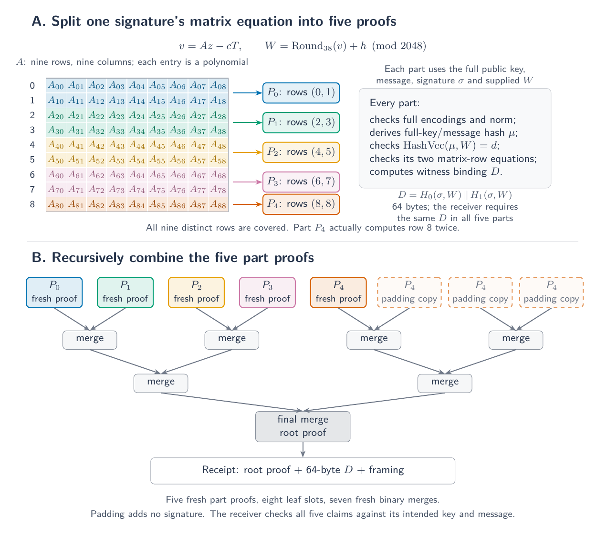

### Splitting Raccoon-G verification across proofs

The original Raccoon verification algorithm is described in **Algorithm 3** of [del Pino et al.](https://eprint.iacr.org/2024/1291.pdf). It checks signature bounds, reconstructs a commitment from a matrix equation, and checks its challenge hash. Our Raccoon-G HD profile follows that structure, using the [HD-wallet authors' implementation](https://github.com/p-11/lattice-hd-wallets/tree/461a5ed9b6d57e3bf8c381be3bb79325ab21d906). The proof decomposition below is our addition.

The expensive step is

$$
v=Az-cT\pmod q,
\qquad T=2^{35}\operatorname{Round}_{35}(t),
$$

where $A$ is a $9\times9$ matrix of polynomials, $z$ is the signature response, $c$ is its challenge polynomial, and $t$ is the full public-key vector. The verifier reconstructs $W=\operatorname{Round}_{38}(v)+h\pmod{2048}$ using the signature hint $h$, then checks $\operatorname{HashVec}(\mu,W)=d$, where $\mu$ binds the full public key and message and $d$ is the signature's challenge digest.

Our whole-signature execution exceeds leanVM's commitment cap: approximately 839 million witness words against a limit of 268 million. We split the computation by matrix rows. Five proofs check rows $(0,1)$, $(2,3)$, $(4,5)$, $(6,7)$ and $(8,8)$. The final row executes twice to retain the same two-row structure. A selected part fits at approximately 234 million words.

Each part still checks all key and signature encodings, the complete norm, and the range of every $W$ coefficient. It hashes the full public key and message and checks the challenge hash against the entire supplied $W$. It then expands its two matrix rows inside the VM and checks their equations. The aggregator prepares $W$, but all nine rows are checked across the five proofs. An individual part is only a partial verification claim.

To prevent parts from using different witnesses, each computes the same 64-byte binding

$$
D=H_0(\operatorname{encode}(\sigma,W))\parallel
H_1(\operatorname{encode}(\sigma,W)),
$$

using two domain-separated BLAKE2s-256 hashes of the complete canonical signature and commitment, with fixed lengths. Each public output binds the profile, part and row indices, full public key, message and $D$. The receiver requires every part in order, with the same $D$ for one signature. For example, changing a hint in row 8 while keeping the supplied $W$ fixed can still satisfy the rows $(0,1)$ checks, but the $(8,8)$ checks reject. Combining parts from the original and modified signatures fails because their bindings differ. This composition relies on applicable witness-knowledge/extraction assumptions and hash binding; the experiment does not establish a new extraction theorem.

We combine these parts through leanVM's native binary recursion circuits. For one signature, five fresh proofs occupy eight padded leaf slots, repeating the final proof for padding, and seven fresh merges produce one root. The backend requires compatible execution shapes, so fixed, charged scratch stores normalize the measured parts without changing their checks. This establishes compatibility for the measured corpus, not every possible future input.

The receiver reconstructs all five expected outputs from its intended public-key/message pair and the receipt's untrusted $D$, then performs complete `Tree::verify`. This checks the root, ordered outputs and all remaining polynomial claims. It needs no signature, $W$ or child proof files. For 100 signatures, the tree contains 500 fresh part proofs, 512 padded slots and 511 merges. The single completed run took **81.77 minutes** and produced a **267.00 KiB receipt**, including framing and bindings, excluding public keys and messages.

The proof authenticates signatures under the final keys. HD derivation paths are outside its statement. Full Raccoon-G paper conformance and parameter-security certification remain pending; the [implemented strict profile](../risc-v/raccoon-g/SPEC.md) documents its canonical encodings and exact integer norm.
