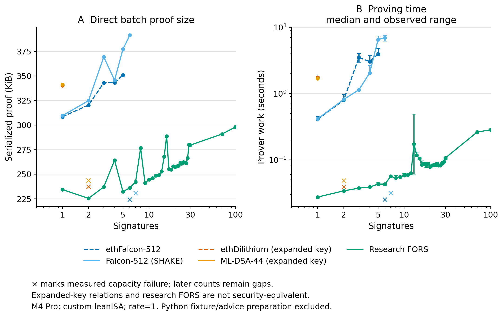
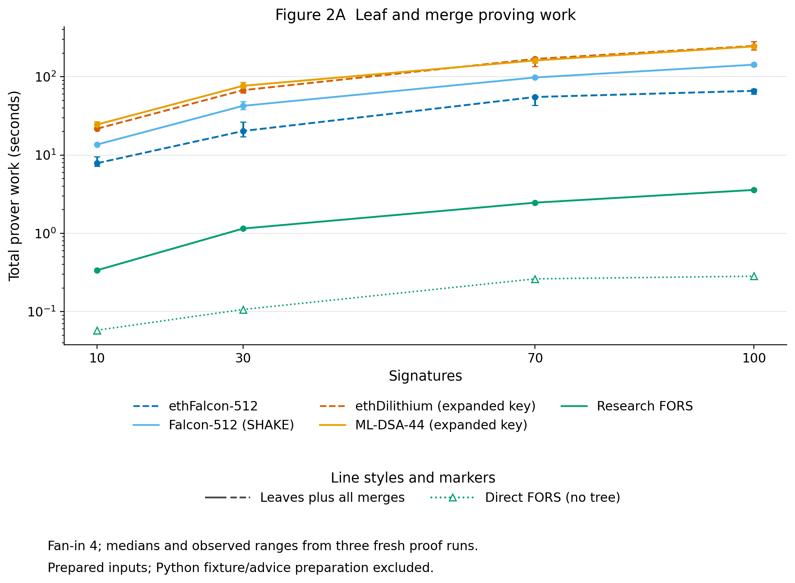
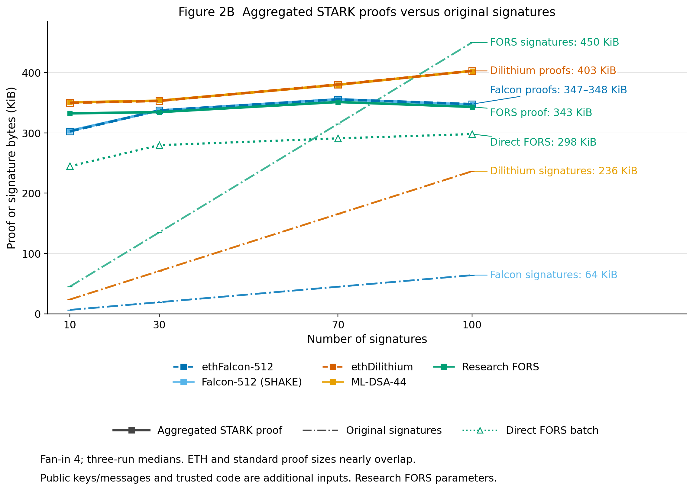
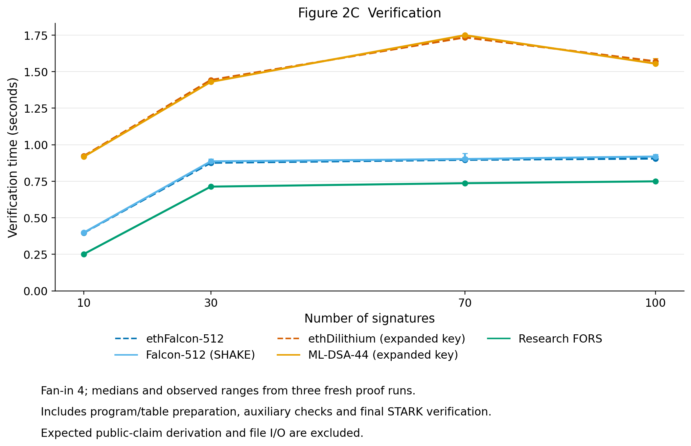

### Motivation

Ethereum is giving the stage to leanSPHINCS as a conservative move to guarantee the long-term security of the chain. However, this choice can come with hurdles whenever key management systems touch the HSM or MPC world. For this reason the draft EIP-8288 can open the door to alternative signatures through its leanSTARK path. 

In this post we focus on tools to perform alternative signature and discuss some of the missing pieces in the EIP-8141/8288 to allow their integration. 

### Alternative sigantures

Besides SPHINCS, there are some other post-quantum signatures worth exploring on their verification under leanVM. Wallets should choose a post-quantum signer suited to their architecture threshold protocol. In this post we present some numbers of STARK proof and verification time for aggregation of ML-DSA, eth-ML-DSA, Falcon, eth-Falcon and FORS. 

### Approach

We explore the current limits of leanVM on the proof size following the [aggregation trees](https://github.com/leanEthereum/leanVM/pull/445) approach.
We mostly want to test the direction of zsfelfoldi's reply #14: batch several dependencies that share a verifier before recursion, so users need not produce a separate STARK for every signature through leanVM. Our aim is to measure that computational building block and understand the limits set by the cap on the leanVM (check why we have the cap and where exactly). 

We use a machine Apple Pro etc.

### Batching limits

As we will see, some signatures can be directly batched inside the same STARK (without recursion). We show below the results and code can be found here.

On the Apple Pro, median native signing takes:

- 1.851/1.860 ms for ETH/standard Falcon and 
- 0.258/0.141 ms for ethDilithium/ML-DSA-44, over 30 fresh samples each.

Also, one standard Falcon proof takes 0.415 seconds and 2.505 GiB process RSS. Its 317,040-byte individual proof contains 486 times as many bytes as its 652-byte signature; both exclude shared key/message/transaction overhead. ML-DSA's proof takes 1.686 seconds and 8.720 GiB.

Figure 1 measures direct batches. An interesting take is that a larger batch does not always make the proof larger. The measured capacity limits are five for ethFalcon, six for standard Falcon, and one for each Dilithium variant. This ceiling comes from hitting leanVM’s capacity limit on the prover’s computation trace. More specifically, the current backend () supports internal commitments only up to a size of 2^28 words. So, the next tested batches exceed that supported size, so the code rejects them before producing a proof. 

### Tree STARK aggregation approach

Next, we handle larger total number of signatures by splitting signatures into the maximum batch numbers and recursively combining their STARK proofs. We start with a tree with arity 4 and then explore some other arity numbers. In this setting the initial proofs are the leaves and then, each merge proves verification of its child proofs, until we reach one final proof at the root. These experiments use up to four children per merge. The pictures below shows this for different number of signatures. 

#### Proving time

Figure 2A shows the total proving work, including producing all leaf proofs plus all merge proofs. Note that each main point is the median of three fresh runs.
The experiment didn't use parallelization which can reduce proving time. The triangular FORS curve shows direct batching for comparison, which avoids the cost of building a proof tree.

#### Proof size

Figure 2B compares aggregated STARK proof sizes with the original signature sizes. For the current tree configuration, we estimate the size break-even to be about 205 signatures for ethDilithium/ML-DSA-44 and 667 for ethFalcon/Falcon-512.

To estimate it, let $N$ be the signature count, $C$ the fixed proof component, $a$ the auxiliary verification bytes added per signature, and $s$ the size of one original signature. All sizes below are in bytes:

$$
P(N)\approx C+aN,\qquad R(N)=sN,
\qquad P(N)<R(N)\LongleftrightarrowN>\frac{C}{s-a}
\quad(s>a).
$$

For this four-child tree, with $b$ signatures per leaf, there are approximately $N/b$ leaves, $N/(3b)$ merges and $4N/(3b)$ edges. Each edge adds 536 bytes of deferred-check data and its length field; each merge adds another 8-byte length field. Thus:

$$
a\approx\frac{4\times536+8}{3b},\qquad
a_{\mathrm{Dilithium}}\approx717.33(b=1),\qquad
a_{\mathrm{Falcon}}\approx143.47(b=5).
$$

Taking $C=340\mathrm{KiB}=348{,}160$ bytes, $s_{\mathrm{Dilithium}}=2{,}420$ and $s_{\mathrm{Falcon}}=666$ gives:

$$
\begin{aligned}
N_{\mathrm{Dilithium}}&>\frac{348{,}160}{2{,}420-717.33}\approx204.5
&&\Rightarrow205\text{ signatures},
N_{\mathrm{Falcon}}&>\frac{348{,}160}{666-143.47}\approx666.3
&&\Rightarrow667\text{ signatures}.
\end{aligned}
$$

We note that these are just projections beyond our 100-signature measurements based on the above assumptions on the proof size. The actual proofs near these counts are needed to confirm them. Also, we excluded public keys and messages from this size comparison.

Considering that current ethereum blocks () contain around 200 transactions, only Falcon signature is underutilized. However, given crypto-agility provided by this solution, the benefits outweight this single case. 

#### Verification time

Figure 2C measures verification of the aggregated STARK proof. The Verifier starts with the intended public key/message pairs and the approved verifier programs. It independently derives the expected leaf commitments, completes the auxiliary checks against trusted code, reconstructs the expected root statement, and verifies the root STARK against that statement and program. Acceptance establishes that a valid signature exists for every intended key/message pair under the implemented signature relation. Changing a key or message changes the expected statement, so the original proof will fail verification.

The plotted time includes preparing the tree programs and verification tables, completing the auxiliary checks and verifying the final STARK. Deriving the expected public claims and loading files are outside the timed interval. For the Dilithium variants, the Verifier derives the expanded-key identity from the compact public key during that earlier claim-derivation step, outside the STARK.

To compare verification work at the projected size break-even counts, we estimate sequential signature verification as $T_{\mathrm{signatures}}(N)\approx Nt_{\mathrm{signature}}$, using the measured per-signature baselines. The same size model gives approximately 78 signatures for research FORS, using 4,608-byte signatures and about 119.47 auxiliary bytes per signature in the tree.

| Scheme                 | Projected size break-even, signatures | Original signatures at that count, ms (estimated) | One STARK for 100 signatures, ms (measured) |
| ---------------------- | ------------------------------------- | ------------------------------------------------- | ------------------------------------------- |
| ethFalcon-512          | 667                                   | 9.11                                              | 905.33                                      |
| Falcon-512             | 667                                   | 6.38                                              | 919.42                                      |
| ethDilithium           | 205                                   | 20.31                                             | 1570.49                                     |
| ML-DSA-44              | 205                                   | 7.59                                              | 1554.51                                     |
| Research FORS (Python) | 78                                    | 39.29                                             | 749.45                                      |

The STARK column uses the existing 100-signature trees. STARK verification at the projected crossover counts has not been measured, so the table does not establish a same-count comparison there. Native totals are linear projections from repeated verification of one saved record per scheme; the lattice baselines use C, while FORS uses a Python/PyCryptodome reference. The STARK timings include program preparation and all auxiliary checks, with public-claim derivation and file I/O excluded as above. A bandwidth break-even point alone does not establish a CPU-verification advantage. [Calculation inputs and scope](../results/article/verification-size-break-even.json).

#### Wasm limitations

Browser proving must accommodate the prover's working memory, even when the final proof is small. Our native one-signature benchmarks reached peak resident RAM of 8.720 GiB for ML-DSA-44, 2.505 GiB for standard Falcon, and 56.6 MiB for research FORS. These are whole-process RSS measurements, including warmups and allocator effects. They indicate memory pressure, but do not establish the exact heap a Wasm implementation would need.

A conventional wasm32 build can address at most 4 GiB in one linear memory, and allocations can fail earlier when the device lacks available RAM. Memory64 allows larger addressing where the browser and toolchain support it, but does not provide extra physical memory. Consequently, moving this ML-DSA prover into a browser would require investigating memory reductions or a larger-memory build; compilation to Wasm alone would not establish feasibility. WebAssembly memory limits.

Falcon is a more plausible desktop-browser candidate, although a multi-GiB prover would leave limited headroom on memory-constrained devices. The much smaller FORS case is the clearest first browser experiment. Both still require a port and browser measurements: native timings and RSS cannot be carried over directly. Until those measurements demonstrate acceptable resource use, the architecture described above lets a browser or phone keep signing local while an off-chain aggregator handles proof generation.

### Architecture discussion

---

However, as pointed out by recent research (cite PRAWNS, [https://cic.iacr.org/p/2/2/24](https://cic.iacr.org/p/2/2/24), [https://eprint.iacr.org/2023/1381.pdf](https://eprint.iacr.org/2023/1381.pdf), [https://csrc.nist.gov/presentations/2026/mpts2026-4b4](https://csrc.nist.gov/presentations/2026/mpts2026-4b4)), the 

Ethereum has proposed a strawman map that was recently updated to push the dates closer to meet the 2029 deadline. At the core of the protocol is

Remove the need for ethFalcon and ethFalcon