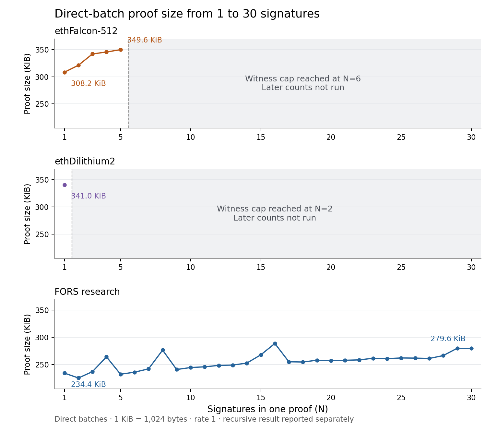

# Single-proof sizes for 1 through 30 signatures

These are actual serialized proof payloads, each verified in a fresh process. They are not recursively aggregated proofs or sums of leaf files. One proof was generated per count at inverse-rate logarithm 1. Size may vary with the input, transcript and pruned Merkle paths. Falcon uses the corrected verifier, without the erroneous 625-byte payload policy. Dilithium replays the saved input from the earlier study.

| Signatures | ethFalcon KiB | ethDilithium KiB | Research FORS KiB |
|---:|---:|---:|---:|
| 1 | 308.2 | 341.0 | 234.4 |
| 2 | 321.1 | capacity failure | 225.4 |
| 3 | 341.8 | not run after cap | 237.1 |
| 4 | 345.4 | not run after cap | 264.2 |
| 5 | 349.6 | not run after cap | 232.3 |
| 6 | capacity failure | not run after cap | 236.1 |
| 7 | not run after cap | not run after cap | 242.2 |
| 8 | not run after cap | not run after cap | 276.6 |
| 9 | not run after cap | not run after cap | 241.0 |
| 10 | not run after cap | not run after cap | 244.6 |
| 11 | not run after cap | not run after cap | 245.9 |
| 12 | not run after cap | not run after cap | 248.5 |
| 13 | not run after cap | not run after cap | 249.2 |
| 14 | not run after cap | not run after cap | 252.8 |
| 15 | not run after cap | not run after cap | 267.9 |
| 16 | not run after cap | not run after cap | 288.8 |
| 17 | not run after cap | not run after cap | 255.2 |
| 18 | not run after cap | not run after cap | 254.8 |
| 19 | not run after cap | not run after cap | 258.0 |
| 20 | not run after cap | not run after cap | 257.4 |
| 21 | not run after cap | not run after cap | 258.0 |
| 22 | not run after cap | not run after cap | 258.6 |
| 23 | not run after cap | not run after cap | 261.6 |
| 24 | not run after cap | not run after cap | 261.0 |
| 25 | not run after cap | not run after cap | 262.2 |
| 26 | not run after cap | not run after cap | 261.9 |
| 27 | not run after cap | not run after cap | 261.3 |
| 28 | not run after cap | not run after cap | 266.6 |
| 29 | not run after cap | not run after cap | 280.1 |
| 30 | not run after cap | not run after cap | 279.6 |

Falcon N=6 and Dilithium N=2 require log committed size 29; the pinned backend accepts at most 28. Counts after the first failed size were not attempted. Those blank ranges are not claims of measured failure at every individual count. A later [recursive experiment](../recursive-30/REPORT.md) now covers 30 ETHFALCON signatures using six leaves and one root; it is a different topology from these direct-batch curves.

FORS size is not monotonic. Power-of-two stacking changes the fraction of committed lanes carrying real data. The backend omits zero tail lanes from Merkle openings; query/path structure also varies. For example, going from N=4 to N=5 reduces opened first-phase field words from 13,380 to 8,028, while the scalar stream grows from 47,696 to 47,840 bytes. The total proof shrinks from 270,584 to 237,904 bytes. This is a measured transport/layout effect, not skipped signature verification.

Exact byte counts, statuses and program hashes are in [CSV](proof-sizes.csv) and [JSON](proof-sizes.json). The sibling size-growth directories contain every successful proof report, cached-verification report, failed-capacity log and proof-encoding breakdown. The full proof files and witness-free statements are under `artifacts/size-growth-*`. Use `scripts/verify_saved.py` to recheck them.

The relations use different encodings and are not security-equivalent. In particular, standalone deterministic FORS is a few-time research component with a chosen-message birthday limitation, and Dilithium authenticates a registered expanded key rather than proving expansion from the compact key. See [the encoding review](../../docs/encoding-review.md).
