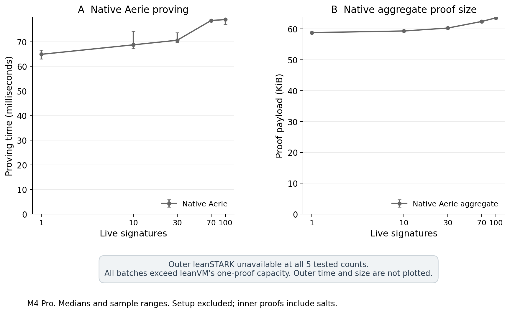
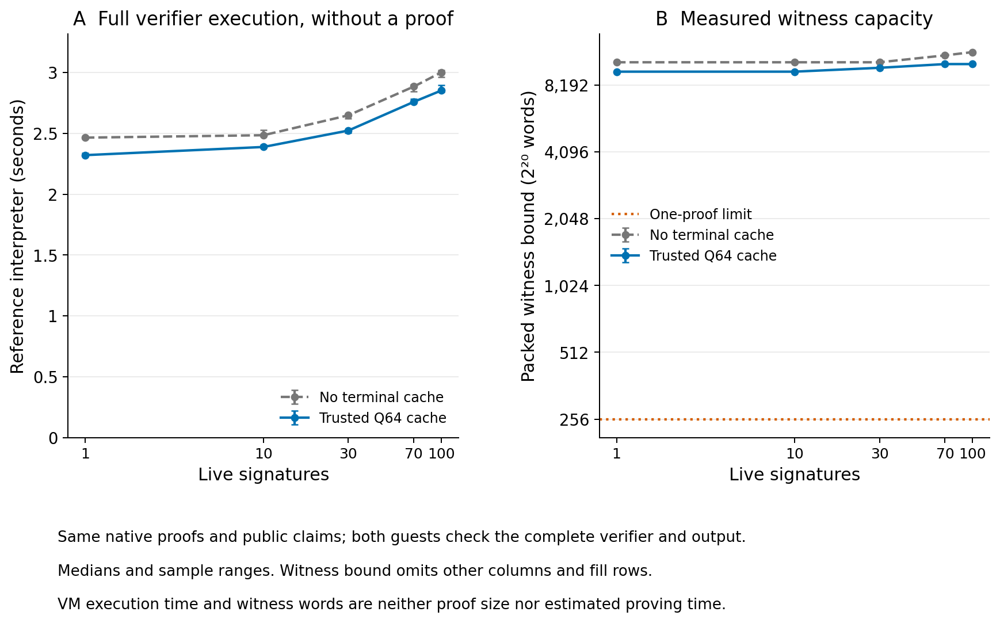

# Complete Aerie verifier under leanVM

The complete verifier guest is implemented and runs correctly on real Aerie aggregates. **No complete Aerie-to-leanSTARK proof was produced:** every actual outer `Prover` call exceeds this leanVM revision's commitment capacity, including one signature. Outer proving time, outer proof size and full Aerie receipt verification therefore remain unavailable.

The experiment uses an M4 Pro with 24 GiB RAM, Rust 1.99.0 for native executables and nightly-2026-10-03 for RV64IM. Aerie is pinned to `49b6c212c209286c536196f53618823ffdf0e899`; leanVM's separate RISC-V checkout is pinned to `06e5c9cd6981103786f9d0a17324241b559a50d3`. The original custom-ISA signature benchmarks remain unchanged.

## Measured stages

Each point has one warmup and three real native proofs, each followed by a complete checked guest interpretation. The native producer uses 12 Rayon workers; the guest is a single-hart scalar program. Signing, fixture acquisition, compilation, setup, ELF loading, statement hashing by the receiver and disk I/O are outside the stage timers shown here. Native verification starts from the parsed statement. Interpretation includes guest parsing, public preprocessing, hashes, Fiat-Shamir, projections, all sumchecks and the entire Akita verifier. It is not proving.

| Signatures | Native Aerie prove, ms | Native Aerie verify, ms | Aerie wire proof, bytes | Full VM execution, s | Outer proof |
|---:|---:|---:|---:|---:|---|
| 1 | 64.88 | 2.75 | 60,239 | 2.321 | Capacity exceeded |
| 10 | 68.73 | 3.04 | 60,777 | 2.388 | Capacity exceeded |
| 30 | 70.59 | 2.99 | 61,752 | 2.523 | Capacity exceeded |
| 70 | 78.61 | 3.35 | 63,935 | 2.759 | Capacity exceeded |
| 100 | 78.98 | 3.46 | 65,138 | 2.853 | Capacity exceeded |

Inner wire sizes include the per-record 40-byte salts. Keys and messages are separate public statement data. Native setup is measured separately in each summary. No failed attempt duration is presented as a successful proving time, and no synthetic host test is included as an Aerie proof.

## Capacity and public preprocessing

The final guest uses 16 MiB RAM, a 1 MiB stack gap and 1 MiB advice. Public matrix and terminal transform data are immutable, natively validated, source-hash-pinned ELF data. Aerie and Akita still perform every proof-dependent check. The Q64 cache extension uses its own target tag and retains exact CRT capacity, tail, residue, geometry, setup and schedule checks. A decoder alone cannot establish that arbitrary in-range transforms are correct, so cache bytes are never read from advice.

The same-source comparison disables only the precomputed terminal cache. Both variants use the same native proof samples and intended statements.

| Signatures | VM without terminal cache, s | VM with terminal cache, s | Instructions with cache, millions | Packed witness lower bound, billion words | Multiple of one-proof capacity |
|---:|---:|---:|---:|---:|---:|
| 1 | 2.465 | 2.321 | 275.99 | 9.849 | 36.69 |
| 10 | 2.485 | 2.388 | 280.45 | 9.849 | 36.69 |
| 30 | 2.648 | 2.523 | 295.27 | 10.252 | 38.19 |
| 70 | 2.885 | 2.759 | 323.58 | 10.655 | 39.69 |
| 100 | 3.002 | 2.853 | 335.46 | 10.655 | 39.69 |

The backend permits at most `2^28` witness words. The lower bound sums only class and clock packed witnesses at independently rounded table heights; it omits other committed columns and additional fill rows. It is neither proof bytes nor an estimate of proving time. At one signature it already represents 73.38 GiB of packed witness words. Raising a size constant would also require sound new commitment parameters and far more prover memory.

A synthetic exit retaining the baseline code and memory heights needs only 5,647,664 committed words. Thus the actual computation, rather than the static program footprint alone, causes the rejection. Selecting only the live count's schedule barely changes the earlier development run because Akita already joins overlapping terminal cache requirements.

## What is checked

The guest canonically parses ordered public keys and messages, validates framing and count, reconstructs each key-prefixed Falcon-v1.2 hash-to-point target from the proof's salts, and calls the complete Aerie verifier. This includes the original BLAKE2b transcript, work nonces, projections, all sumcheck stages and Akita opening verification. It commits the exact profile/count/statement claim only after acceptance. There is no host acceptance bit or unchecked proof-dependent target table.

The implemented receiver requires a trusted ELF SHA-256 and the intended canonical statement/count, derives the expected public output independently, and calls full `Program::verify`, including deferred obligations. The inner proof, salts and original signatures would be private outer witnesses. No successful full receipt exists to exercise this receiver end to end in this experiment. The default backend mode is plain; zero knowledge was not benchmarked.

## Correctness evidence and limits

Both frozen variants accept all 15 measured native proof inputs and all five warmups with the expected output. Twelve invalid guest controls trap: changed message, key, salt, proof body, record order, truncated/trailing inner proof, truncated/trailing outer frame, oversized header, wrong count and nonzero advice padding. A separately valid reordered aggregate is accepted with its different independently computed claim digest. These controls run in the actual reference VM, bypassing host prevalidation where needed.

The native cache checker verifies all five original Aerie proofs, compares cached multiplication with direct ring arithmetic with and without the exactness tail, rejects malformed cache encodings and checks Q128/Q64 separation. All four release host tests pass, including a real small synthetic STARK binding the expected output, program and exact proof bytes. That synthetic proof is a backend contract test, not an Aerie proof.

The scoped review found no false acceptance in the inspected wrapper/runtime/cache paths. It is not a cryptanalysis or security audit of Aerie, Akita, the single-hart runtime or leanVM. Full Aerie receipt mutation controls cannot run until an honest outer proof fits. A hash-based outer proof would also retain the inner lattice assumptions.

## Reproduction and next step

The [reproduction guide](../../docs/aerie-wrapper-reproduction.md), [target contract](../../docs/aerie-wrapper-target.md), [review](../../docs/aerie-wrapper-review.md), `guest-build-manifest.json`, `provenance.json`, per-count raw reports and figure CSV/JSON retain the exact boundaries and identities. Final proof files were not emitted. Failed prover attempts are preserved separately from complete interpretation reports.

This implementation is a starting point for a circuit-oriented verifier or a backend with authenticated continuations. Efficient scalar SHAKE/BLAKE2b and prime-field arithmetic paths would also help. None is implemented here as a shortcut. The present port does not yet supply an EIP-8288 dependency proof, transaction object, gas estimate or benchmark of native PQ_SIG integration.
